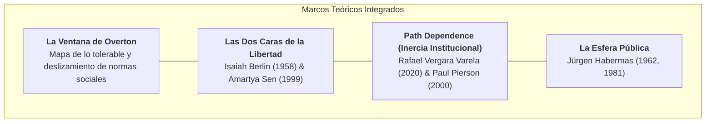
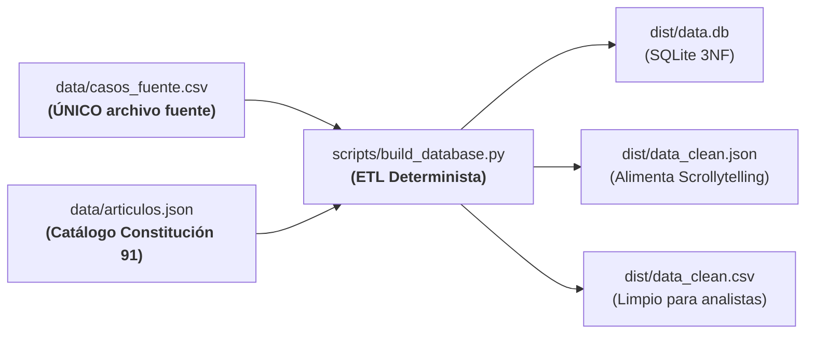
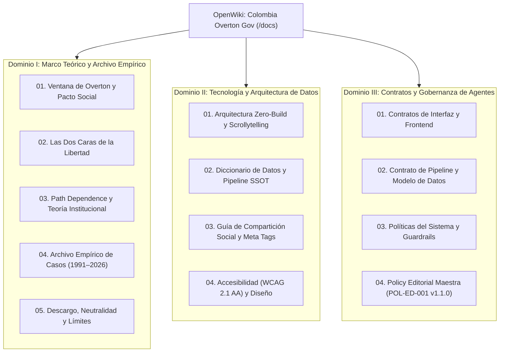

# Colombia Overton Gov

> **Un ensayo interactivo, observatorio computacional y archivo empírico sobre el desplazamiento de la tolerancia democrática y la fractura del pacto social de la Constitución de 1991 en Colombia (1991–2026).**  
> *An interactive essay, computational observatory, and empirical archive exploring the shift of democratic tolerance and the fracture of the 1991 Colombian Constitutional social pact (1991–2026).*

[](https://willkwolf.github.io/colombia-overton-gov/)
[](https://creativecommons.org/licenses/by-nc-sa/4.0/deed.es)
[](./docs/02-tecnologia-y-arquitectura/01-arquitectura-zero-build-y-scrollytelling.md)
[](./docs/02-tecnologia-y-arquitectura/04-accesibilidad-y-diseno-responsivo.md)
[](./docs/02-tecnologia-y-arquitectura/02-diccionario-de-datos-y-pipeline-ssot.md)
[](./docs/README.md)

---

## 🌐 Índice General / Table of Contents

* 🇪🇸 **[Versión en Español](#-español)**
  * [1. ¿Qué es Colombia Overton Gov?](#1-qué-es-colombia-overton-gov)
  * [2. Marco Conceptual y Lentes Teóricos](#2-marco-conceptual-y-lentes-teóricos)
  * [3. Arquitectura de Datos y Principio SSOT](#3-arquitectura-de-datos-y-principio-ssot)
  * [4. Archivo Empírico de Casos (1991–2026)](#4-archivo-empírico-de-casos-19912026)
  * [5. Experiencia Interactiva y Scrollytelling](#5-experiencia-interactiva-y-scrollytelling)
  * [6. OpenWiki: Centro Documental y Gobernanza (`/docs`)](#6-openwiki-centro-documental-y-gobernanza-docs)
  * [7. Descargo de Responsabilidad y Neutralidad Política](#7-descargo-de-responsabilidad-y-neutralidad-política)
  * [8. Cómo Citar y Ecosistema de Fuentes](#8-cómo-citar-y-ecosistema-de-fuentes)
* 🇬🇧 **[English Version](#-english)**
  * [1. What is Colombia Overton Gov?](#1-what-is-colombia-overton-gov)
  * [2. Theoretical Framework & Analytical Lenses](#2-theoretical-framework--analytical-lenses)
  * [3. Data Architecture & Single Source of Truth (SSOT)](#3-data-architecture--single-source-of-truth-ssot)
  * [4. Empirical Case Archive (1991–2026)](#4-empirical-case-archive-19912026)
  * [5. Interactive Scrollytelling Experience](#5-interactive-scrollytelling-experience)
  * [6. OpenWiki: Living Documentation by Domains (`/docs`)](#6-openwiki-living-documentation-by-domains-docs)
  * [7. Disclaimer & Multipartisan Political Neutrality](#7-disclaimer--multipartisan-political-neutrality)
  * [8. How to Cite & Academic Sources](#8-how-to-cite--academic-sources)

---

# 🇪🇸 Español

## 1. ¿Qué es Colombia Overton Gov?

En el debate político contemporáneo colombiano, los escándalos de corrupción, el espionaje gubernamental, el desvío de presupuestos de emergencia y la violencia armada suelen reducirse a la confrontación de hinchadas partidistas o al olvido mediático. Quienes participan en la discusión pública asumen con frecuencia que la indignación individual basta, sin comprender las dinámicas sistémicas que hacen que estas conductas se repitan administración tras administración.

**Colombia Overton Gov** interrumpe este bucle de cinismo. Concebido como un artefacto pedagógico, observatorio computacional y ensayo de investigación independiente, el proyecto descompone cómo las acciones del poder ejecutivo y las fallas del Estado han tensionado y fracturado los acuerdos éticos de la **Constitución Política de 1991**:

* ¿Por qué nos parece normal hoy lo que en 1991 era considerado aberrante e impensable?
* ¿Cómo se articulan la coacción estatal contra la disidencia (*libertad negativa*) y el desvío de recursos que destruye las oportunidades de vida (*libertad sustantiva*)?
* ¿Por qué las reformas legales y los cambios de gobierno no logran frenar el deterioro institucional (*dependencia de la trayectoria*)?
* ¿Qué rol cumple la degradación de la esfera pública habermasiana en normalizar el costo de «hacer política»?

---

## 2. Marco Conceptual y Lentes Teóricos

El proyecto articula cuatro marcos de la filosofía política, la sociología y el institucionalismo histórico:



1. **La Ventana de Overton (Joseph Overton / Russell Lehman):** Adaptada como modelo hermenéutico de la tolerancia al daño institucional. Mide cómo una práctica estatal intolerable (ej. compra de votos con recursos humanitarios o ejecuciones extrajudiciales) pasa de ser **impensable** a ser considerada **radical**, luego **discutible** y finalmente **normalizada** como el costo inevitable de gobernar.
2. **Las Dos Caras de la Libertad (Isaiah Berlin & Amartya Sen):** La Constitución de 1991 como Estado Social de Derecho exige el balance simultáneo entre la *libertad de coacción* (no ser espiado ni ejecutado por el Estado) y la *libertad sustantiva* (precondiciones materiales, educación y conectividad rural). El proyecto demuestra cómo el desvío de recursos públicos debilita la libertad material, lo que a su vez empuja a los gobiernos a violar las libertades civiles para contener el descontento resultante.
3. **Dependencia de la Trayectoria (*Path Dependence* — Vergara Varela, 2020):** La investigación histórica de Rafael Vergara Varela demuestra que las costumbres informales de planeación cortoplacista y clientelismo en Colombia persistieron inalteradas tras los hitos de 1990 (apertura) y 1991 (Constitución), atrapando a los gobiernos sucesivos en una senda de rendimientos crecientes de la inercia (*lock-in*).
4. **La Esfera Pública (*Öffentlichkeit* — Jürgen Habermas):** Análisis de cómo la polarización y la justificación facciosa de las transgresiones destruyen la deliberación racional compartida, sustituyendo el debate democrático por trincheras de justificación recíproca.

---

## 3. Arquitectura de Datos y Principio SSOT

El proyecto aplica una **separación taxativa entre datos fácticos y lentes interpretativos**, organizada bajo el principio de **Único Origen de Verdad (Single Source of Truth - SSOT)**:



### Invariantes del Pipeline:
* **Edición Exclusiva en `data/casos_fuente.csv`:** Queda prohibida la edición manual de los archivos en `dist/`.
* **Desacople Fáctico-Interpretativo:** Las columnas cuantitativas y de hechos duros (`monto_millones_cop`, `victimas`, `tiene_condenas_firmes`) están aisladas de las variables analíticas de Overton (`overton_gravedad`, `overton_novedad`, `nivel_responsabilidad`).
* **Compilación:** Ejecuta `python scripts/build_database.py` o `npm run build:data` para regenerar todos los artefactos de distribución.

---

## 4. Archivo Empírico de Casos (1991–2026)

El conjunto de datos contiene **19 casos de estudio de producción** respaldados exclusivamente en fallos judiciales en firme de las altas cortes (Corte Suprema, Corte Constitucional), autos de la JEP e informes de organismos multilaterales (ONU, CIDH):

| Caso | Periodo | Presidente / Ámbito | Gravedad | Novedad | Condenas | Artículos Clave |
| :--- | :---: | :--- | :---: | :---: | :---: | :--- |
| `GEN_ANS90_01` | 1990–1998 | Estructural (Gaviria/Samper) | 5 / 5 | 2 / 5 | No | 2, 11, 93, 95 |
| `GEN_DPL90_01` | 1990–2002 | Estructural (Gaviria/Samper/Pastrana) | 4 / 5 | 2 / 5 | No | 2, 11, 25, 44, 93 |
| `GEN_LED90_01` | 1990–2002 | Estructural (Gaviria/Samper/Pastrana) | 5 / 5 | 2 / 5 | No | 2, 11, 93, 95, 102 |
| `GAV_91_01` | 1991–1994 | César Gaviria (Hito Fundacional) | 0 / 5 | 5 / 5 | N/A | 1, 2, 93, 113, 122 |
| `SAM_8000_01` | 1994–1998 | Ernesto Samper (Proceso 8.000) | 5 / 5 | 5 / 5 | Sí (mandos) | 40, 107, 109, 113 |
| `PAS_PAZ_01` | 1998–2002 | Andrés Pastrana (Despeje del Caguán) | 4 / 5 | 3 / 5 | No | 2, 11, 22, 93, 95 |
| `URB_FP_03` | 2002–2008 | Álvaro Uribe (Falsos Positivos) | 5 / 5 | 4 / 5 | Sí (militares) | 2, 11, 12, 28, 29, 93 |
| `GEN_LED_01` | 2002–2026 | Estado Colombiano (Líderes Sociales) | 5 / 5 | 3 / 5 | Parcial | 2, 11, 93, 95 |
| `GEN_DESPL_01`| 2002–2026 | Estado Colombiano (Desplazamiento T-025) | 5 / 5 | 3 / 5 | Sí (Corte T-025)| 2, 11, 28, 93 |
| `URB_YIDIS_01`| 2003–2004 | Álvaro Uribe (Yidispolítica) | 5 / 5 | 5 / 5 | Sí (ministros) | 1, 3, 40, 113, 114 |
| `URB_DAS_02` | 2003–2009 | Álvaro Uribe (Chuzadas del DAS) | 4 / 5 | 4 / 5 | Sí (directores)| 15, 21, 29, 113 |
| `URB_PARA_05` | 2006–2008 | Álvaro Uribe (Parapolítica) | 5 / 5 | 5 / 5 | Sí (>60 cong.)| 1, 2, 40, 113, 122, 133 |
| `URB_AIS_04` | 2007–2009 | Álvaro Uribe (Agro Ingreso Seguro) | 4 / 5 | 3 / 5 | Sí (ministro) | 13, 64, 65, 363, 366 |
| `SAN_FP_02` | 2010–2014 | Juan Manuel Santos (FP Residuales) | 4 / 5 | 2 / 5 | Sí (mandos) | 2, 11, 12, 28, 29, 93 |
| `SAN_ODEB_01` | 2013–2014 | Juan Manuel Santos (Odebrecht 2014) | 4 / 5 | 3 / 5 | Sí (gerente) | 40, 107, 109, 113 |
| `DUQ_ESMAD_01` | 2019–2021 | Iván Duque (Paro Nacional) | 4 / 5 | 4 / 5 | Sí (policías) | 2, 11, 20, 37, 93 |
| `DUQ_CP_02` | 2020–2021 | Iván Duque (Centros Poblados) | 4 / 5 | 3 / 5 | Sí (contrat.) | 2, 44, 67, 356, 363 |
| `PET_LIDERES_02`| 2022–2025| Gustavo Petro (Líderes Rurales) | 4 / 5 | 2 / 5 | En proceso | 2, 11, 93, 95 |
| `PET_UNGRD_01` | 2023–2024 | Gustavo Petro (UNGRD y Congreso) | 5 / 5 | 4 / 5 | En proceso | 1, 2, 3, 40, 113, 122, 363 |

---

## 5. Experiencia Interactiva y Scrollytelling

La interfaz pública (`index.html`, `app.js`, `styles.css`) implementa una experiencia de lectura interactiva controlada por el scroll:
* **Panel Sticky («Lente de la Deriva»):** En pantallas grandes acompaña la lectura en el lateral izquierdo; en dispositivos móviles se compacta en la barra superior.
* **Termómetro Acumulado de Overton:** Visualiza en tiempo real el umbral histórico máximo de gravedad alcanzado hasta el punto de la lectura.
* **Desbloqueo Secuencial de Tarjetas:** Motor optimizado con `IntersectionObserver` nativo; preserva el acceso y lectura de casos pasados.
* **Zero-Build Nativo:** 100% HTML5, CSS3 y ES6+ vanilla, sin dependencias de compiladores en tiempo de ejecución.

---

## 6. OpenWiki: Centro Documental y Gobernanza (`/docs`)

Toda la base de conocimiento, la teoría institucional, los contratos de gobierno y las políticas del sistema están documentadas de manera viva bajo el directorio [`/docs`](./docs/README.md) mediante **Docsify / OpenWiki**:



Para visualizar la documentación localmente con recarga en vivo:
```bash
npm run wiki:serve
# o alternativamente:
npx docsify serve docs
```

---

## 7. Descargo de Responsabilidad y Neutralidad Política

* **Propósito Académico e Investigativo:** Este recurso busca elevar la deliberación cívica fundamentada en datos empíricos. No posee fines comerciales, partidistas ni proselitistas.
* **Naturaleza No Judicial:** Los indicadores `overton_gravedad`, `overton_novedad` y `nivel_responsabilidad` representan estimaciones teóricas y cualitativas de la investigación. **No constituyen determinaciones de responsabilidad penal ni civil**, las cuales competen exclusivamente a la Rama Judicial de Colombia.
* **Neutralidad Multipartidista:** El estándar de análisis se aplica de manera rigurosa y uniforme a gobiernos de todas las tendencias políticas (Gaviria, Samper, Pastrana, Uribe, Santos, Duque, Petro y estructuras de Estado), sin contemplaciones ideológicas.

---

## 8. Cómo Citar y Ecosistema de Fuentes

Si utilizas este observatorio, su conjunto de datos o su marco conceptual en investigaciones académicas, reportajes periodísticos o análisis de políticas públicas, por favor cita formalmente:

### Formato APA 7
```text
Artunduaga Viana, W. C. (2026). Colombia Overton Gov: Análisis del impacto institucional y la tensión democrática sobre la Constitución de 1991 (1991–2026) [Artefacto computacional y conjunto de datos]. GitHub. https://github.com/willkwolf/colombia-overton-gov
```

### Formato BibTeX
```bibtex
@misc{artunduaga2026colombiaoverton,
  author       = {Artunduaga Viana, William Camilo},
  title        = {{Colombia Overton Gov: An{\'a}lisis del impacto institucional y la tensi{\'o}n democr{\'a}tica sobre la Constituci{\'o}n de 1991 (1991--2026)}},
  year         = {2026},
  publisher    = {GitHub},
  howpublished = {\url{https://github.com/willkwolf/colombia-overton-gov}},
  note         = {Dataset y artefacto analítico de Scrollytelling}
}
```

---

# 🇬🇧 English

## 1. What is Colombia Overton Gov?

In contemporary Colombian political discourse, corruption scandals, state surveillance, emergency fund diversion, and systemic armed violence are frequently reduced to partisan hostility or fleeting media cycles. Public discussions often focus on emotional reactions while overlooking the deeper institutional inertia that causes these transgressions to replicate across successive presidential administrations.

**Colombia Overton Gov** disrupts this pattern. Conceived as a pedagogical tool, computational observatory, and independent research essay, this project analyzes how executive actions and systemic failures have continuously tested and fractured the ethical foundation established by the **1991 Political Constitution of Colombia**:

* Why has society normalized practices in 2026 that were considered unthinkable and unacceptable in 1991?
* How do state coercion against dissent (*negative liberty*) and public fund diversion that erodes substantive opportunities (*positive liberty*) reinforce each other?
* Why have constitutional reforms and administration changes failed to reverse historical institutional decline (*path dependence*)?
* What role does the degradation of the Habermasian public sphere play in trivializing political transgressions as an ordinary cost of governance?

---

## 2. Theoretical Framework & Analytical Lenses

The project integrates four theoretical lenses from political philosophy, sociology, and historical institutionalism:

1. **The Overton Window (Joseph Overton / Russell Lehman):** Adapted as a conceptual model for democratic damage tolerance. It maps how an unacceptable state practice (e.g., vote-buying using humanitarian funds or extrajudicial executions) shifts over time from **unthinkable** to **radical**, **acceptable/debatable**, and ultimately **normalized** as a routine cost of power.
2. **The Two Faces of Liberty (Isaiah Berlin & Amartya Sen):** The 1991 Constitution established a Social Rule of Law that requires a balance between *freedom from coercion* (not being unlawfully wiretapped or killed by state forces) and *substantive capabilities* (access to rural education, infrastructure, and health). The project demonstrates that diverting public resources destroys substantive freedom, which later pushes the state to deploy coercive measures to suppress public unrest.
3. **Path Dependence & Historical Institutionalism (Vergara Varela, 2020):** Empirical research by Rafael Vergara Varela reveals that informal practices of short-term planning and clientelistic capture persisted despite the structural reforms of 1990 (economic opening) and 1991 (new Constitution), locking the state into self-reinforcing inertia.
4. **The Public Sphere (*Öffentlichkeit* — Jürgen Habermas):** Explores how extreme partisan polarization damages rational civic deliberation, replacing institutional scrutiny with reciprocal excuses.

---

## 3. Data Architecture & Single Source of Truth (SSOT)

The system maintains an absolute separation between **raw empirical facts** and **interpretive analytical categories**, managed through a strict **Single Source of Truth (SSOT)** pipeline:

* **Single Human Entry Point (`data/casos_fuente.csv`):** The only editable source file. Direct edits inside `/dist` are strictly prohibited.
* **Strict Schema & Validation:** Quantitative and logical columns (`monto_millones_cop`, `victimas`, `tiene_condenas_firmes`) hold pure atomic types (`FLOAT`, `INTEGER`, `BOOLEAN`) without textual adjectives or formatting symbols.
* **Deterministic Build:** The standalone script `scripts/build_database.py` validates all inputs against the 1991 Constitutional catalog (`data/articulos.json`) and compiles:
  - `dist/data.db`: Fully normalized SQLite database (3NF) for relational queries.
  - `dist/data_clean.json`: Enriched JSON feeding the interactive frontend.
  - `dist/data_clean.csv`: Clean, typed CSV ready for analysis in Python/Pandas, R, and Stata.

---

## 4. Empirical Case Archive (1991–2026)

The observatory documents **19 verified production cases** covering 1990 to 2026. Every entry is backed by public rulings from Colombia's Supreme Court, Constitutional Court, Special Jurisdiction for Peace (JEP), and multilateral human rights reports (UN OHCHR, IACHR).

Cases examine structural issues and administrations across the political spectrum:
* Structural violence and forced displacement in the 1990s and 2000s (César Gaviria, Ernesto Samper, Andrés Pastrana).
* Drug-cartel campaign financing (Proceso 8.000 — Ernesto Samper).
* The Caguán demilitarized peace experiment (Andrés Pastrana).
* Extrajudicial executions ("False Positives" peak and residual cases — Álvaro Uribe, Juan Manuel Santos).
* Unlawful constitutional reform vote-buying (Yidispolítica — Álvaro Uribe).
* Political intelligence and illegal wiretapping (Chuzadas del DAS — Álvaro Uribe).
* Paramilitary co-optation of Congress (Parapolítica — Álvaro Uribe).
* Regressive irrigation subsidies (Agro Ingreso Seguro — Álvaro Uribe).
* Transnational campaign financing (Odebrecht 2014 — Juan Manuel Santos).
* Disproportionate riot control and protest repression (2019–2021 National Strike — Iván Duque).
* School connectivity contract diversion (Centros Poblados — Iván Duque).
* Rural social leader homicides persistence (Gustavo Petro).
* Humanitarian emergency fund diversion and legislative bribery (UNGRD — Gustavo Petro).

---

## 5. Interactive Scrollytelling Experience

The frontend web application (`index.html`, `app.js`, `styles.css`) is engineered as an immersive, scroll-driven interactive experience:
* **Sticky Status Panel ("Lens of Drift"):** Displays current observation year, maximum accumulated Overton gravity, normalization status badge, and dynamic path dependence reflections.
* **Sequential Card Illumination:** Native `IntersectionObserver` updates interface state while keeping previous timeline entries fully unlocked and readable.
* **Zero-Build Architecture:** Pure HTML5, CSS custom properties, and modular vanilla ES6+. Zero runtime framework overhead, zero bundling dependencies, built for long-term digital preservation (> 30 years).
* **WCAG 2.1 AA Certified:** High contrast ratios ($> 4.5:1$), tap targets $\ge 44 \times 44\text{ px}$, zero horizontal layout overflow.

---

## 6. OpenWiki: Living Documentation by Domains (`/docs`)

All system knowledge, theoretical essays, data dictionaries, interface contracts, and AI agent guardrails are documented under [`/docs`](./docs/README.md) using **Docsify / OpenWiki**:

* **Domain I: Theoretical Framework & Empirical Archive (`docs/01-marco-teorico/`)**
* **Domain II: Technology, Data Architecture & Pipeline (`docs/02-tecnologia-y-arquitectura/`)**
* **Domain III: Governance Contracts, Master Editorial Policy & Guardrails (`docs/03-contratos-y-tests/`)**

Run the documentation server locally:
```bash
npm run wiki:serve
# or via docsify-cli directly:
npx docsify serve docs
```

---

## 7. Disclaimer & Multipartisan Political Neutrality

* **Educational & Research Mission:** This project provides an academic and civic tool for data-driven deliberation. It is non-commercial, non-partisan, and carries no electoral agenda.
* **Non-Judicial Assessment:** Metrics such as `overton_gravedad`, `overton_novedad`, and `nivel_responsabilidad` are analytical heuristics developed by the research team. **They do not constitute legal determinations of criminal or civil liability**, which belong exclusively to the judicial courts of Colombia.
* **Multipartisan Neutrality:** The analytical model applies uniformly across all presidential administrations and structural state dynamics without ideological favoritism.

---

## 8. How to Cite & Academic Sources

When using this observatory, its datasets, or analytical framework in research, academic work, or investigative journalism, please cite:

### APA 7
```text
Artunduaga Viana, W. C. (2026). Colombia Overton Gov: Analysis of institutional impact and democratic tension on the 1991 Constitution (1991–2026) [Computational artifact and dataset]. GitHub. https://github.com/willkwolf/colombia-overton-gov
```

### BibTeX
```bibtex
@misc{artunduaga2026colombiaoverton,
  author       = {Artunduaga Viana, William Camilo},
  title        = {{Colombia Overton Gov: Analysis of institutional impact and democratic tension on the 1991 Constitution (1991--2026)}},
  year         = {2026},
  publisher    = {GitHub},
  howpublished = {\url{https://github.com/willkwolf/colombia-overton-gov}},
  note         = {Dataset and scrollytelling research artifact}
}
```

---

### Licencia / License
Este proyecto está bajo la Licencia **Creative Commons Atribución-NoComercial-CompartirIgual 4.0 Internacional (CC BY-NC-SA 4.0)**.  
*This work is licensed under a Creative Commons Attribution-NonCommercial-ShareAlike 4.0 International License.*
