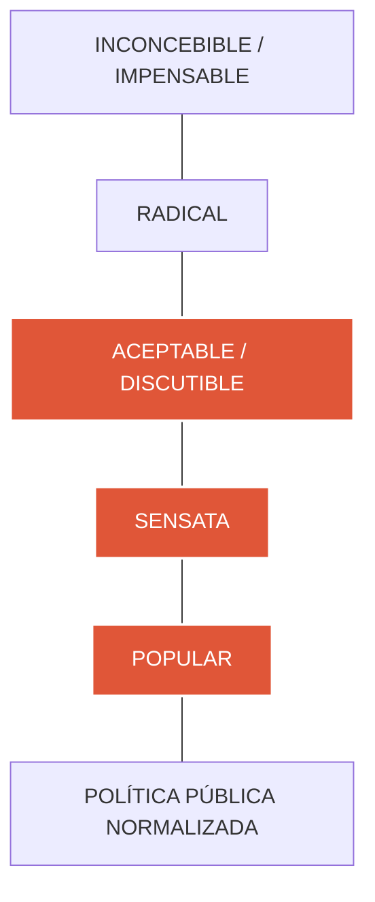
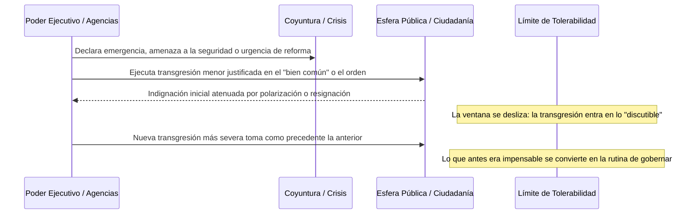

# 1. La Ventana de Overton y la Fractura del Pacto Social

> *«¿Por qué nos parece normal lo que antes era intolerable?»*

---

## 1.1. Origen y Definición de la Ventana de Overton

El concepto de la **Ventana de Overton** fue formulado originalmente a mediados de la década de 1990 por **Joseph P. Overton** (Centro Mackinac de Políticas Públicas) para describir el espectro de ideas y políticas que el público y la clase política consideran aceptables dentro del clima de opinión de una sociedad en un momento dado.

En su formulación original, la ventana clasifica las posturas frente a una política pública en un eje vertical graduado:

Las políticas situadas **dentro de la ventana** son viables electoral e institucionalmente; las situadas **fuera de la ventana** son consideradas aberrantes, escandalosas o inviables.

### Adaptación del Modelo al Daño Institucional
En este proyecto, la Ventana de Overton se traslada de la teoría de políticas públicas a la **sociología del poder y el control institucional**:
- En lugar de medir preferencias tributarias o regulatorias, la ventana mide el **umbral de tolerancia colectiva frente a transgresiones del poder público**.
- El punto de referencia inicial (ancla axiológica) es el consenso ético de la **Constitución Política de 1991**.

---

## 1.2. El Pacto Constitucional de 1991 como Ancla Axiológica

La Constitución de 1991 representó en la historia contemporánea de Colombia un **puerto de llegada y punto de partida democrático**. Surgida tras una década de crisis terminal marcada por el narcoterrorismo, el exterminio de movimientos políticos y la parálisis estatal, la Asamblea Nacional Constituyente refundó el contrato social bajo la fórmula del **Estado Social de Derecho** (Art. 1).

Este pacto estableció fronteras nítidas sobre el ejercicio del poder público:
1. **Inviolabilidad de la dignidad humana y los derechos fundamentales:** Vida (Art. 11), integridad (Art. 12), intimidad (Art. 15), libertad de conciencia y expresión (Arts. 18 y 20).
2. **Separación funcional y colaboración armónica de poderes:** Frenos y contrapesos recíprocos entre Ejecutivo, Legislativo y Judicial (Art. 113).
3. **Moralidad y transparencia administrativa:** Prohibición estricta de la desviación del poder para beneficio faccioso o patrimonial (Arts. 122 y 123).

En 1991, conductas como la compra abierta de votos parlamentarios con notarías, la interceptación clandestina a magistrados de las altas cortes o el soborno a legisladores con fondos para desastres naturales pertenecían formalmente al terreno de lo **impensable** e **inaceptable**.

---

## 1.3. La Mecánica del Deslizamiento: De la Excepción a la Rutina

El desplazamiento de la Ventana de Overton no suele operar mediante quiebres constitucionales abruptos (como golpes de Estado militares clásicos), sino a través de un **proceso acumulativo de micro-erosiones justificadas**:

Cuando un abuso de poder es tolerado o legitimado por una parte de la sociedad bajo pretextos de pragmatismo político (*«el fin justifica los medios»*, *«la seguridad está por encima de las formas»* o *«las reformas populares justifican la transacción burocrática»*), el límite de lo tolerable desciende irreversiblemente.

---

## 1.4. Conexión con la Esfera Pública de Habermas

El análisis se fundamenta teóricamente en la noción de **esfera pública (*Öffentlichkeit*)** desarrollada por **Jürgen Habermas** (*Historia y crítica de la opinión pública*, 1962; *Teoría de la acción comunicativa*, 1981):

1. **La Esfera Pública como Espacio de Deliberación Racional:**  
   Para Habermas, la legitimidad democrática depende de un espacio discursivo donde los ciudadanos deliberan mediante argumentos racionales sobre el interés colectivo, libres de coacción y manipulación instrumental.
2. **La Colonización y Degradación del Debate:**  
   Cuando los escándalos de corrupción o violencia institucional se convierten en moneda corriente, la esfera pública se fragmenta en trincheras de lealtad partidista (*«hinchadas presidenciales»*). La deliberación racional es sustituida por el cinismo colectivo: *«todos roban, pero los míos hacen obras»* o *«los otros fueron peores»*.
3. **El Costo Democrático:**  
   La normalización de conductas transgresoras priva a la ciudadanía de la capacidad de indignación moral compartida, desmantelando el control cívico sobre las instituciones.

---

## 1.5. Preguntas Clave para la Deliberación Ciudadana

1. ¿Hasta qué punto la sociedad colombiana ha aprendido a convivir con niveles intolerables de corrupción y violencia simplemente porque se han vuelto predecibles?
2. ¿Qué responsabilidad le cabe a la polarización mediática y a las redes sociales en acelerar el desplazamiento de la ventana hacia la justificación facciosa del abuso?
3. ¿Cómo puede una ciudadanía informada activar mecanismos de reconstrucción institucional para devolver estas prácticas al terreno de lo impensable?
