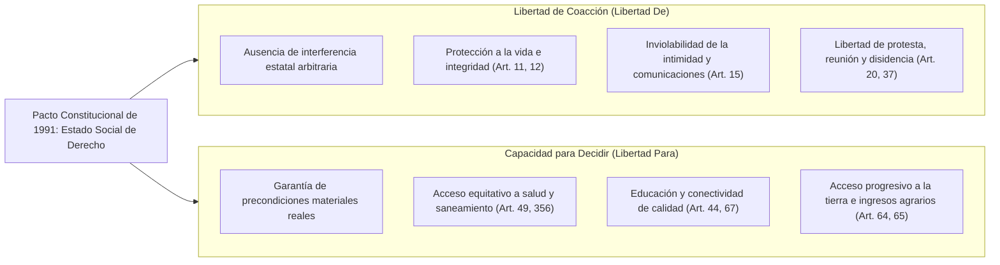
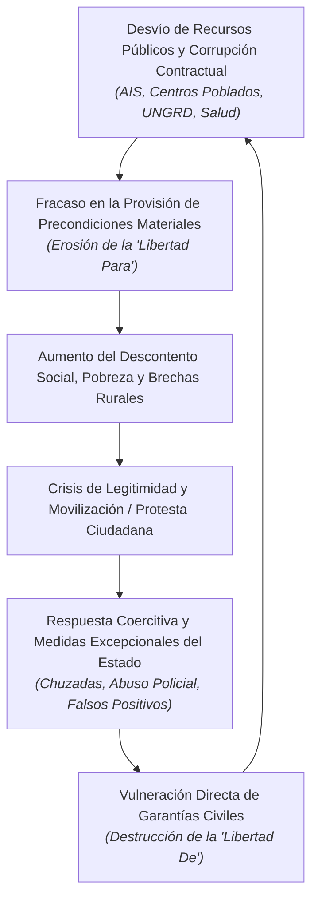

# 2. Las Dos Caras de la Libertad en el Estado Colombiano

> *«La libertad para los lobos ha significado con frecuencia la muerte para los corderos.»*  
> — **Isaiah Berlin (1958)**

---

## 2.1. El Pacto Constitucional y la Doble Dimensión de la Libertad

La Constitución de 1991 no consagró un modelo libertario puro de abstención estatal ni un modelo colectivista autoritario; concibió a Colombia como un **Estado Social de Derecho** fundado en el equilibrio simultáneo de dos expresiones de la libertad humana:

### 1. Libertad frente al abuso («Libertad de» — Isaiah Berlin)
La garantía negativa fundamental de que el individuo no será sometido a la coacción arbitraria del poder. Implica que el Estado tiene prohibido interceptar clandestinamente a los ciudadanos, desaparecerlos, ejecutarlos o criminalizar sus opiniones políticas.

### 2. Capacidad para decidir («Libertad para» — Amartya Sen & Martha Nussbaum)
La provisión real de oportunidades y funcionamientos sustantivos. Como advierten Sen y Berlin, proclamar que un campesino o un niño de una zona rural aislada es «libre» de elegir su proyecto de vida cuando carece de escuelas, agua potable o conectividad es una burla semántica: la libertad jurídica sin precondiciones materiales es una **promesa vacía**.

---

## 2.2. La Ruptura del Balance: El Bucle Trágico Colombiano

En la historia institucional reciente de Colombia (1991–2026), la erosión de ambas dimensiones no ocurre de forma aislada, sino mediante un **bucle de retroalimentación perversa**:

### La Cascada Causal:
1. **Pérdida de la *Libertad Para*:**  
   Cuando los fondos destinados al desarrollo agrícola equitativo terminan concentrados en élites adineradas (Agro Ingreso Seguro), o cuando el anticipo para conectar escuelas rurales es capturado por contratistas ficticios (Centros Poblados), o cuando los recursos para mitigar la sed de comunidades desérticas se desvían para comprar voluntades políticas (UNGRD), el Estado cercena la libertad sustantiva de millones de ciudadanos vulnerables.
2. **Reacción Coercitiva y Destrucción de la *Libertad De*:**  
   Al agudizarse la desigualdad y la protesta social, el aparato gubernamental —presionado por sostener la gobernabilidad o imponer sus reformas— recurre a atajos autoritarios: espionaje clandestino contra contradictores (Chuzadas del DAS), represión desproporcionada de manifestaciones (Paro Nacional 2019-2021) o incentivación perversa de resultados operacionales a costa de la vida de civiles (Falsos Positivos).

---

## 2.3. Vínculo con el Ecosistema Canónico

Este análisis se apoya directamente en la investigación matriz documentada en la [Infografía Interactiva de la Libertad (Anatomía de la Libertad)](https://willkwolf.github.io/isaiah-berlin-liberty-infographic/), la cual demuestra que:
- La libertad negativa y la igualdad sustantiva colisionan de manera inevitable (*conflicto trágico de valores*).
- Toda sociedad democrática debe gestionar esa colisión con transparencia institucional y sin sacrificar las garantías básicas de la persona humana.
- En Colombia, el pacto constitucional de 1991 fijó un umbral civilizatorio que las inercias del poder han intentado flexibilizar repetidamente.
