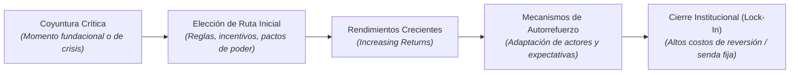
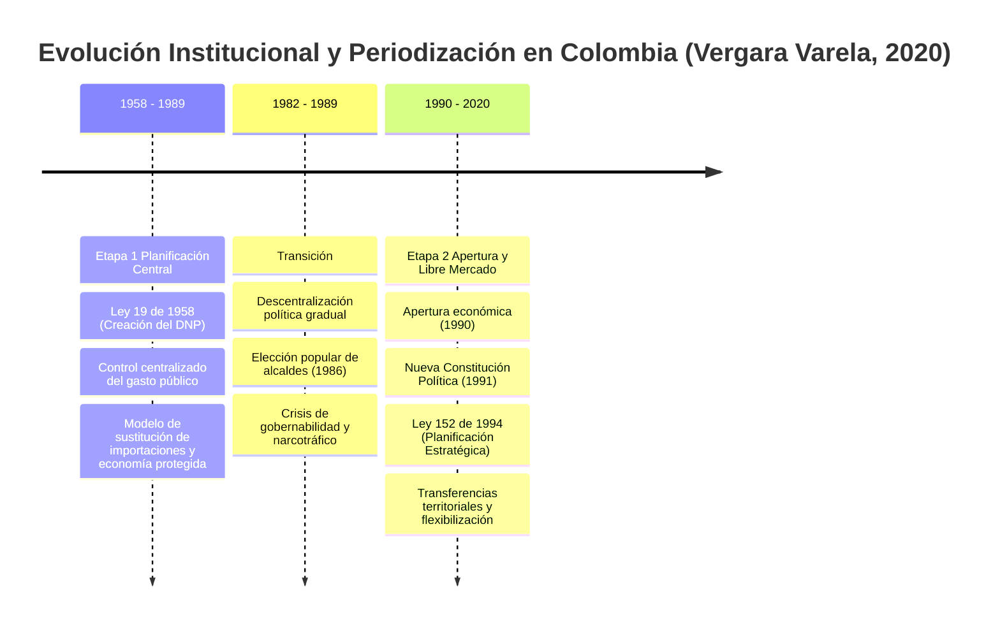
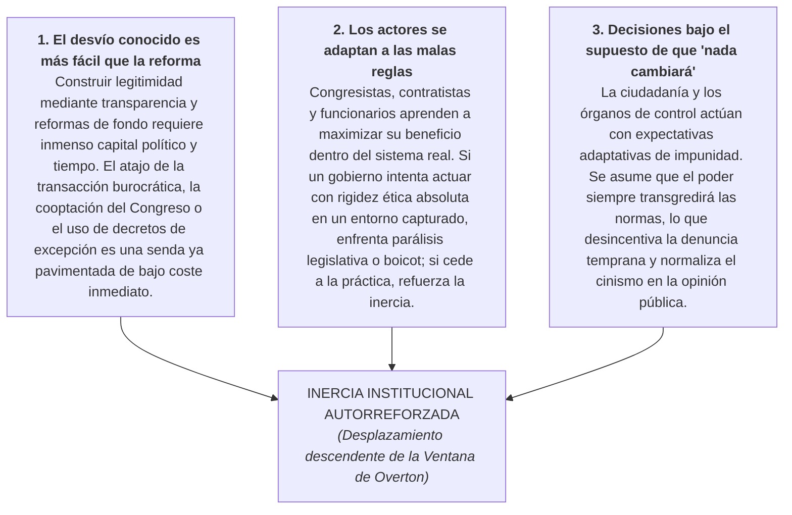

# 3. Dependencia de la Trayectoria (Path Dependence) y Teoría Institucional

> *«Una vez que un país se encamina por una senda institucional, los costes de cambiar de dirección son inmensos. Las inercias del pasado funcionan como rieles invisibles que guían el futuro.»*  
> — Adaptado de **Paul Pierson (2000)** y **Rafael Vergara Varela (2020)**

---

## 3.1. Fundamentos Teóricos del Institucionalismo Histórico

El **institucionalismo histórico** (Thelen, Steinmo, Hall, Pierson) postula que las instituciones no son simples arenas neutrales donde compiten intereses coyunturales, sino legados históricos persistentes estructurados por reglas formales e informales que condicionan la distribución del poder a lo largo de décadas.

Dentro de esta corriente, el concepto de **Dependencia de la Trayectoria (*Path Dependence*)** (W. Brian Arthur, 1989; Douglass North, 1990; Paul Pierson, 2000) explica por qué ciertas trayectorias ineficientes o perversas persisten en el tiempo:

### Propiedades Clave de la Dependencia de Trayectoria:
1. **Rendimientos Crecientes (*Increasing Returns*):** Cada paso dado en una senda específica incrementa los beneficios relativos de continuar por ella y eleva los costes de abandonarla.
2. **Consecuencias no intencionadas:** Decisiones adoptadas para solucionar una urgencia coyuntural crean estructuras que sobreviven a sus creadores y limitan el margen de los gobiernos posteriores.
3. **Cierre o Bloqueo (*Lock-in*):** Superado cierto umbral histórico, resulta casi imposible corregir el rumbo mediante decretos ordinarios, requiriéndose una crisis sistémica o una coyuntura crítica mayor para alterar la trayectoria.

---

## 3.2. La Evidencia Empírica en Colombia: Tesis de Vergara Varela (2020)

En su investigación seminal *Path dependence en el desarrollo histórico-institucional, político-administrativo y sectorial en Colombia (1960-2020)* (Revista *Justicia*, 25(37), 85-98), el profesor **Rafael Vergara Varela** (Universidad del Valle) analiza la evolución de la administración pública colombiana identificando dos grandes periodos:

### La Paradoja de la Persistencia
El hallazgo central del estudio demuestra que, a pesar de la radicalidad formal de los hitos de 1990 y 1991:
- Las **costumbres políticas informales** de captura clientelista, planeación a corto plazo y desvío patrimonial de los recursos públicos **no se quebraron**, sino que mutaron para adaptarse a las nuevas reglas.
- La descentralización administrativa y los nuevos presupuestos del Sistema General de Participaciones (SGP) fueron absorbidos por las maquinarias locales, consolidando una trayectoria de erosión continua.

---

## 3.3. Los Tres Mecanismos Cotidianos de la Inercia

¿Por qué los gobiernos sucesivos en Colombia (de diversas ideologías) terminan replicando patrones de transgresión similares? El modelo describe tres mecanismos de refuerzo:

---

## 3.4. Referencias y Archivo Documental

- **Cita Principal (APA 7):**  
  Vergara Varela, R. (2020). *Path dependence en el desarrollo histórico-institucional, político-administrativo y sectorial en Colombia (1960-2020)*. *Justicia*, 25(37), 85-98. DOI: [https://doi.org/10.17081/just.25.37.3673](https://doi.org/10.17081/just.25.37.3673).
- **Documento Fuente Primaria:**  
  El artículo completo en formato PDF se encuentra archivado en el repositorio bajo:  
  [📄 `docs/assets/Paper1.pdf`](../assets/Paper1.pdf).
