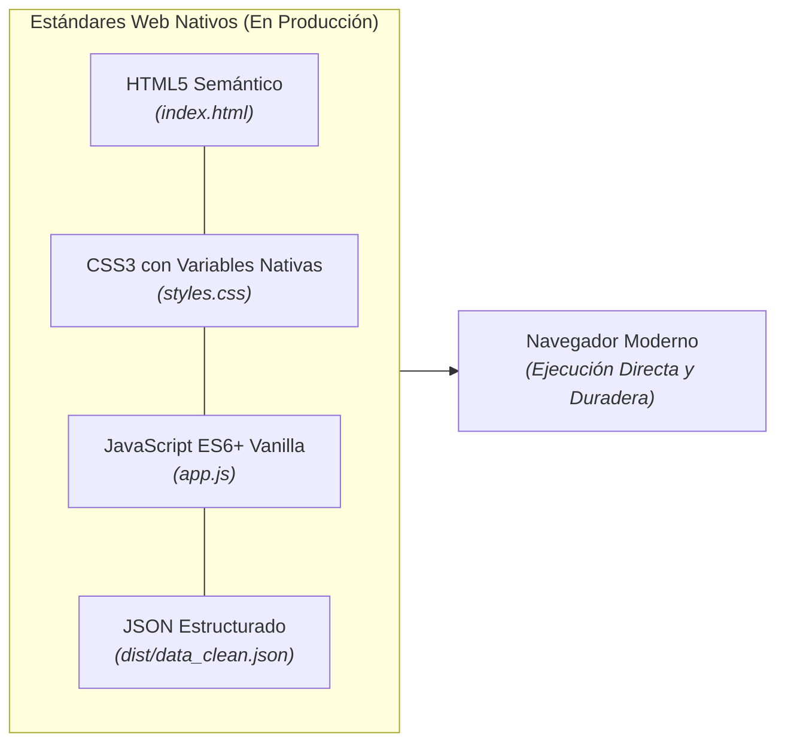
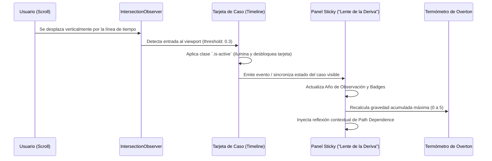

# 1. Arquitectura Zero-Build y Mecánica de Scrollytelling

> *«La mejor dependencia es la que no existe. Un artefacto digital concebido para la memoria histórica debe poder ejecutarse sin alteraciones dentro de 30 años en cualquier navegador estándar.»*

---

## 1.1. Filosofía Técnica Zero-Build

En contraposición a las tendencias del desarrollo web contemporáneo que introducen pesadas cadenas de compilación, transpilación y empaquetado (Node modules, Webpack, Vite), **Colombia Overton Gov** se construye bajo el estándar de **Zero-Build Vanilla**:

### Ventajas Operativas y Epistémicas:
1. **Inmunidad a la Obsolescencia de Herramientas:** No existen riesgos de que una versión deprecada de un bundler o plugin de Node impida reconstruir el sitio web en el futuro.
2. **Auditoría Transparente:** Cualquier usuario o revisor puede inspeccionar el código fuente directamente en el navegador con la herramienta *Ver código fuente* (`Ctrl+U`), sin capas de código ofuscado o minificado incomprensible.
3. **Rendimiento Máximo:** Cero overhead de frameworks reactivos pesados. La aplicación carga en milisegundos y consume una fracción mínima de memoria RAM.

---

## 1.2. Mecánica del Motor de Scrollytelling

La experiencia interactiva central se basa en una narrativa visual guiada por el desplazamiento vertical (scroll). El motor está orquestado en [`app.js`](../../app.js) a través de la API nativa del navegador **`IntersectionObserver`**:

---

## 1.3. El Panel Sticky y el Termómetro de Overton

El panel lateral fijo (*«Lente de la Deriva»*) cumple una función pedagógica isomórfica: **hace visible al lector el coste invisible de la inercia institucional acumulada**:

1. **Año de Observación:** Sincronizado con el caso enfocado en la pantalla.
2. **Umbral de Aceptabilidad (Máxima Gravedad Acumulada):**
   - No mide únicamente la gravedad aislada del caso actual, sino el **techo histórico de transgresión** que la sociedad ya ha asimilado previamente.
   - El termómetro asciende de forma acumulativa, reflejando cómo cada escándalo tolerado pavimenta el camino para el siguiente.
3. **Escala de Normalización (Badges):**
   - `0`: **Impensable** (Pacto constitucional intacto).
   - `1 a 2`: **Radical** (Primeras desviaciones toleradas).
   - `3 a 4`: **Aceptable / Discutible** (Justificación coyuntural de transgresiones graves).
   - `5`: **Normalizado** (Asimilación de violaciones fundamentales como costo ordinario de la gobernabilidad).
4. **Inercia Acumulada:** Bloque narrativo dinámico que verbaliza las restricciones estructurales que heredará la siguiente administración.

---

## 1.4. Arquitectura de Despliegue en GitHub Pages

El repositorio se despliega de forma estática en **GitHub Pages** mediante el flujo automatizado [`.github/workflows/deploy.yml`](../../.github/workflows/deploy.yml).

- Las actualizaciones sobre los datos fuente (`data/casos_fuente.csv`) disparan la compilación automática de la base de datos y la regeneración instantánea del sitio web público.
