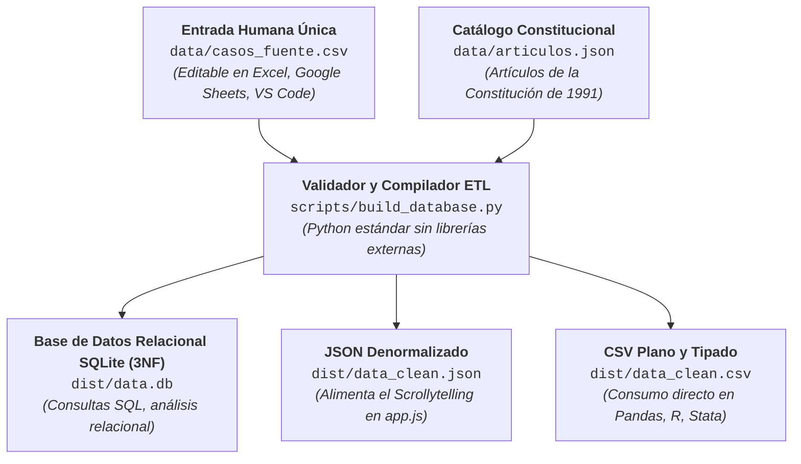
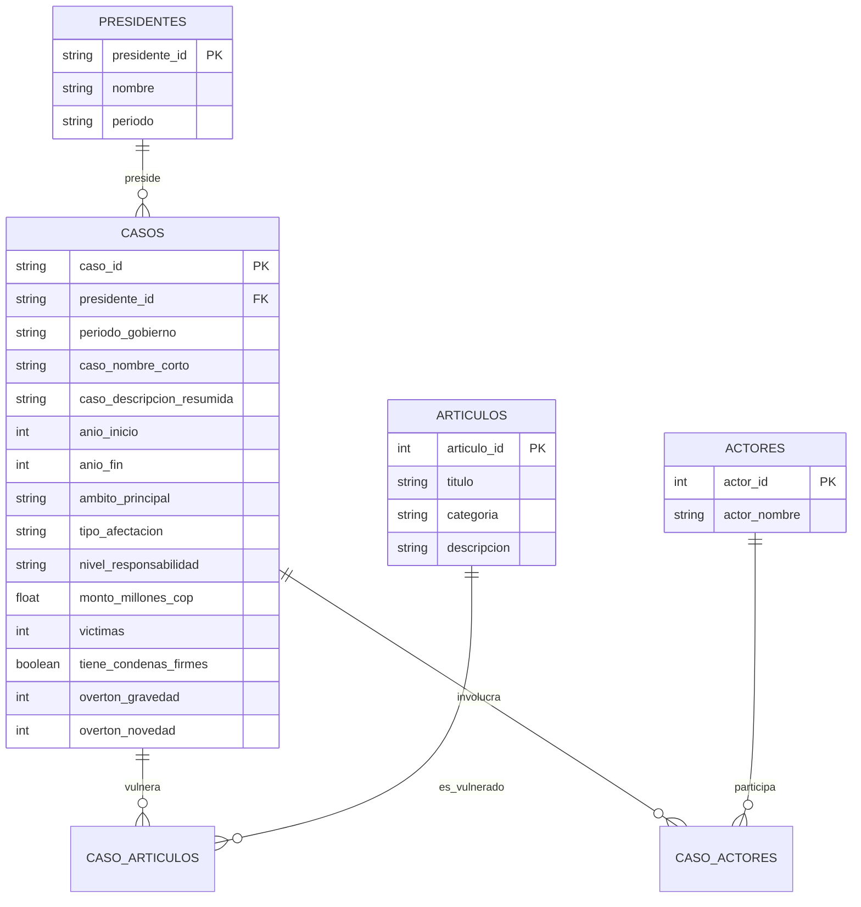

# 2. Diccionario de Datos y Pipeline SSOT (Single Source of Truth)

> *«Un único origen de datos para la edición humana; múltiples artefactos especializados y optimizados para el consumo computacional.»*

---

## 2.1. Arquitectura de Datos y Pipeline de Compilación

Para evitar la desincronización y garantizar que cualquier modificación sea trazable en Git, el proyecto se estructura bajo el principio de **Único Origen de Verdad (Single Source of Truth - SSOT)**:



### Reglas de Mantenimiento:
1. **Edición Exclusiva en `data/casos_fuente.csv`:** Queda estrictamente prohibido editar manualmente los archivos en `dist/`. Cualquier cambio debe realizarse en el CSV fuente.
2. **Ejecución Determinista del Pipeline:**
   ```bash
   python scripts/build_database.py
   # o vía npm:
   npm run build:data
   ```
   El script valida la tipación, verifica que los artículos referenciados existan en el catálogo y reconstruye atómicamente todos los artefactos de salida.

---

## 2.2. Esquema Técnico del Archivo Fuente (`data/casos_fuente.csv`)

| Nombre de Columna | Tipo de Datos | Restricciones / Formato | Regla de Contenido / Descripción |
| :--- | :---: | :--- | :--- |
| **`caso_id`** | `VARCHAR` | Patrón: `^[A-Z]{3}_[A-Z0-9]+_\d{2}$` | **Clave Primaria (PK).** Identificador único y legible (ej. `URB_YIDIS_01`, `PET_UNGRD_01`). |
| **`presidente`** | `Enum` | Vocabulario controlado | Nombre del mandatario o etiqueta "estructural". |
| **`periodo_gobierno`** | `String` | Formato: `YYYY–YYYY` | Periodo constitucional de ocurrencia de los hechos. |
| **`caso_nombre_corto`** | `VARCHAR(80)`| Máximo 80 caracteres | Rótulo sintético estandarizado para gráficos y títulos. |
| **`caso_descripcion_resumida`**| `TEXT` | Sin adjetivos de juicio | Estructura mandatoria: *Verbo + Objeto + Objetivo*. |
| **`anio_inicio`** | `INTEGER` | Año numérico | Año de inicio de los hechos centrales (ej. `2003`). |
| **`anio_fin`** | `INTEGER` | Año numérico | Año del quiebre institucional principal (ej. `2004`). |
| **`ambito_principal`** | `Enum` | Vocabulario controlado | Dominio constitucional primario afectado. |
| **`tipo_afectacion`** | `String` | Texto descriptivo | Descripción sintética del mecanismo transgresor. |
| **`nivel_responsabilidad`**| `Enum` | Vocabulario controlado | Categorización de la vinculación del poder ejecutivo. |
| **`evidencia_responsabilidad`**| `TEXT`| Citas y sentencias | Síntesis de fallos o informes probatorios que vinculan al mandatario. |
| **`monto_millones_cop`**| `FLOAT` | **Solo número** (o `NULL`) | Monto económico público comprometido. Sin texto ni símbolos de moneda. |
| **`monto_detalles`** | `TEXT` | Texto descriptivo | Aclaraciones metodológicas sobre la estimación económica. |
| **`victimas`** | `INTEGER` | **Solo número** (o `0`/`NULL`) | Estimación numérica de víctimas humanas directas. |
| **`victimas_detalles`** | `TEXT` | Texto descriptivo | Notas sobre el origen institucional de las cifras de víctimas. |
| **`tiene_condenas_firmes`**| `BOOLEAN`| `true` / `false` | Indica si existen sentencias penales ejecutoriadas en firme. |
| **`condenas_detalles`** | `TEXT` | Texto descriptivo | Nombres de personas condenadas y corporaciones judiciales sentenciadoras. |
| **`articulos_constitucionales`**| `String`| Separado por comas | Números de artículos de la Constitución de 1991 vulnerados (ej. `"1, 3, 40"`). |
| **`actores_clave`** | `String` | Separado por comas | Personas naturales o agencias directamente vinculadas a los hechos. |
| **`overton_gravedad`** | `INTEGER` | Escala ordinal 0 a 5 | Gravedad constitucional (0 = Hito democrático; 5 = Quiebre de pilares). |
| **`overton_novedad`** | `INTEGER` | Escala ordinal 1 a 5 | Novedad del hecho (1 = Asimilado históricamente; 5 = Inédito/inconcebible). |

---

## 2.3. Vocabularios Controlados

### 1. Valores Permitidos para `ambito_principal`:
- `"Democracia / poder público"`
- `"Libertad / privacidad"`
- `"Seguridad / derecho a la vida"`
- `"Igualdad / política agraria"`
- `"Corrupción electoral"`
- `"Corrupción / derechos sociales"`
- `"Seguridad / libertades públicas"`
- `"Seguridad / DD. HH."`
- `"Corrupción / democracia"`
- `"Democracia / institución"`
- `"Corrupción electoral / Democracia"`
- `"Seguridad / política de paz"`
- `"Seguridad / derechos sociales"`

### 2. Valores Permitidos para `nivel_responsabilidad`:
1. `"directa"`: El presidente impulsa la decisión o se beneficia de manera central y directa, vinculándose estrechamente a su gestión.
2. `"directa_beneficio"`: El ejecutivo es beneficiario directo de la conducta, independientemente de pruebas judiciales de orden expresa.
3. `"politica_fuerte"`: Conductas sistemáticas ligadas a incentivos, directrices o estructuras creadas conscientemente por el gobierno.
4. `"politica_fuerte_en_debate"`: Casos bajo investigación activa donde existe negligencia grave u omisión en la supervisión de cuadros.
5. `"estructural_con_intentos_correccion"`: Patrones de violación estructural generalizada donde el gobierno intentó formalmente corregir la conducta pero no pudo revertir el patrón.
6. `"institucional_hito"`: Hito fundacional e institucional positivo que instaura el nuevo pacto constitucional de 1991.
7. `"estructural"`: Violencia y/o desplazamiento estructural generalizado no atribuible a un único presidente de manera individual.

---

## 2.4. Modelo Relacional SQLite (`dist/data.db`)

El compilador genera un esquema físico en **Tercera Forma Normal (3NF)**:


