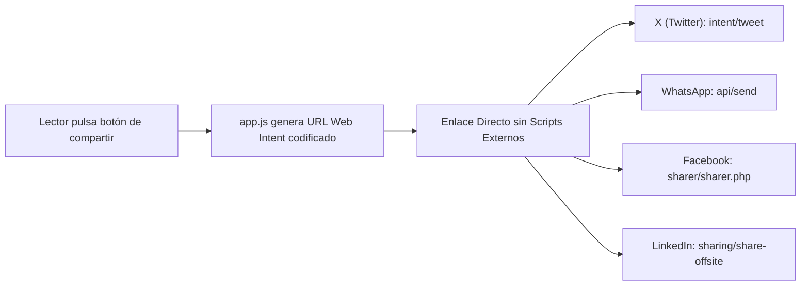

# 3. Guía de Compartición Social Premium y Metadatos Open Graph

> *«La difusión en redes sociales debe ser ágil, elegante y respetuosa de la privacidad del lector: cero rastreadores externos, máxima fidelidad estética.»*

---

## 3.1. Objetivos de Diseño y Privacidad

1. **Privacidad Absoluta (Cero Scripts de Terceros):**  
   Bloqueo total del uso de SDKs o iframes externos de redes sociales (Facebook Pixel, Twitter Widgets, Google Tag Manager). Estos scripts inyectan cookies de rastreo masivo, comprometen la privacidad del usuario y ralentizan la carga de la página.
2. **Estética Editorial Monocromática:**  
   Prohibición del uso de los colores corporativos estridentes de cada red dentro del flujo de lectura. La botonera se diseña bajo la paleta neutra y sobria del ensayo (carbón, marfil, bordes finos de lino).
3. **Mínima Fricción Cognitiva:**  
   Accesos situados estratégicamente al final de las secciones reflexivas o conclusiones para permitir la compartición inmediata.

---

## 3.2. Arquitectura de Compartición Nativa (Web Intents)

La compartición se realiza exclusivamente a través de los protocolos nativos de enlace de cada plataforma (**Web Intents**). El navegador o la aplicación instalada en el dispositivo móvil gestiona la acción de forma directa:



### URLs de Web Intents:
* **X (Twitter):**  
  `https://twitter.com/intent/tweet?text={TEXTO_ENCODED}&url={URL_ENCODED}`
* **WhatsApp:**  
  `https://api.whatsapp.com/send?text={TEXTO_ENCODED}%20{URL_ENCODED}`
* **Facebook:**  
  `https://www.facebook.com/sharer/sharer.php?u={URL_ENCODED}`
* **LinkedIn:**  
  `https://www.linkedin.com/sharing/share-offsite/?url={URL_ENCODED}`

*Nota de Implementación:* Todos los textos y URLs dinámicos deben procesarse previamente con la función nativa `encodeURIComponent()` en JavaScript para evitar la corrupción de caracteres especiales y saltos de línea.

---

## 3.3. Configuración Mandatoria de Metadatos Open Graph

A diferencia de X y WhatsApp (que admiten parámetros de texto en el URL), **Facebook y LinkedIn ignoran el parámetro de texto personalizado** para prevenir el spam, y extraen automáticamente el título, descripción e imagen de previsualización directamente de las etiquetas `<meta>` del encabezado `<head>`:

```html
<!-- Metadatos Canónicos Open Graph en index.html -->
<meta property="og:type" content="article" />
<meta property="og:title" content="Colombia Overton — La Fractura del Pacto Social" />
<meta property="og:description" content="¿Por qué nos parece normal lo que antes era intolerable? Explora el mapa interactivo del desplazamiento de la Ventana de Overton frente a la Constitución de 1991." />
<meta property="og:url" content="https://willkwolf.github.io/colombia-overton-gov/" />
<meta property="og:image" content="https://willkwolf.github.io/colombia-overton-gov/assets/og-cover.png" />

<!-- Tarjetas de Twitter / X -->
<meta name="twitter:card" content="summary_large_image" />
<meta name="twitter:title" content="Colombia Overton — La Fractura del Pacto Social" />
<meta name="twitter:description" content="¿Por qué nos parece normal lo que antes era intolerable? Mapa interactivo 1991–2026." />
<meta name="twitter:image" content="https://willkwolf.github.io/colombia-overton-gov/assets/og-cover.png" />
```

---

## 3.4. Reglas de Accesibilidad y Tap Targets en Móviles

1. **Objetivos Táctiles Accesibles:**  
   En dispositivos móviles, cada botón de la botonera debe tener un alto mínimo de `44px` y padding suficiente para cumplir con el estándar **WCAG 2.1 AA (Criterio 2.5.5)**.
2. **Iconografía SVG Vectorial Nativa:**  
   Uso exclusivo de iconos `<svg>` en línea con `fill="currentColor"`. No usar tipografías externas de iconos ni imágenes en mapa de bits (PNG/JPG).
