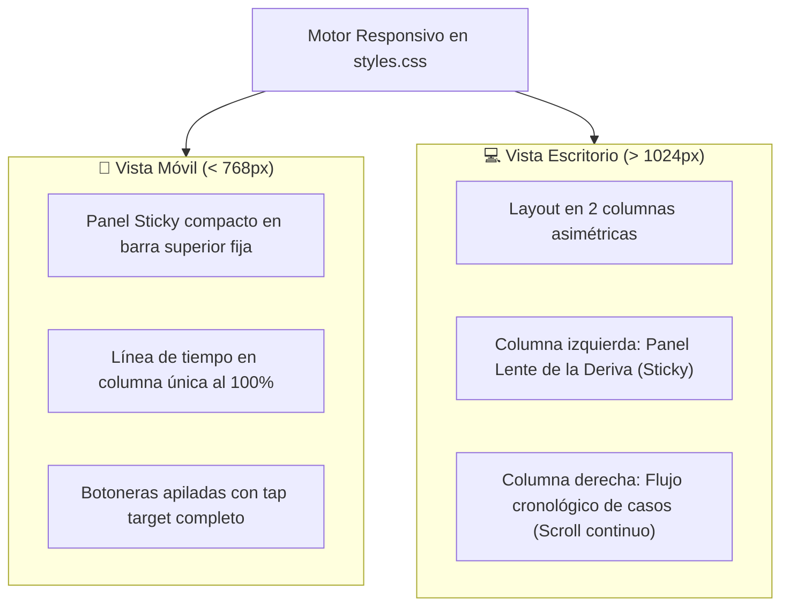

# 4. Accesibilidad Perceptual (WCAG 2.1 AA) y Diseño Responsivo

> *«La accesibilidad no es un agregado cosmético; es un imperativo ético consustancial a un proyecto que analiza los derechos y las libertades constitucionales.»*

---

## 4.1. Tokens del Sistema de Diseño (`styles.css`)

El sistema visual se apoya en una escala sobria y editorial gobernada por variables nativas de CSS (Custom Properties):

```css
:root {
  /* Paleta cromática neutra y acentos de gravedad */
  --bg-primary: #f8f6f0;           /* Fondo general cálido (marfil/alabastro) */
  --bg-surface: #ffffff;           /* Superficie de tarjetas y modales */
  --text-primary: #1a1a1a;         /* Texto principal de alto contraste */
  --text-secondary: #5a5a5a;       /* Texto secundario y notas técnicas */
  --border-light: rgba(0, 0, 0, 0.08); /* Delimitadores finos */
  
  /* Escala semántica de Overton */
  --overton-impensable: #2c7a7b;   /* Verde azulado frío: normalidad constitucional */
  --overton-radical: #d69e2e;      /* Ámbar: desvío moderado */
  --overton-discutible: #dd6b20;   /* Naranja: justificación coyuntural */
  --overton-normalizado: #c53030;  /* Rojo óxido: quiebre asimilado */

  /* Tipografía y espaciado */
  --font-serif: "Newsreader", "Georgia", serif;
  --font-sans: -apple-system, BlinkMacSystemFont, "Segoe UI", Roboto, sans-serif;
  --font-mono: "JetBrains Mono", "Fira Code", monospace;
  
  /* Objetivos táctiles */
  --tap-target-min: 44px;
}
```

---

## 4.2. Criterios de Accesibilidad WCAG 2.1 AA

1. **Ratio de Contraste Cromático (Criterio 1.4.3):**  
   - Todo texto de cuerpo normal (`16px`) mantiene una relación de contraste con su fondo **superior a 4.5:1**.
   - Los títulos principales y textos destacados (`H1`, `H2`, números de año) superan una relación de **7:1**.
   - Los colores de los badges de Overton se acompañan de texto explícito (no se transmite información exclusivamente mediante color).
2. **Dimensiones de Objetivos Táctiles (Criterio 2.5.5):**  
   - Todos los botones interactivos, pestañas de casos y controles de filtrado cumplen con la dimensión mínima de **$44 \times 44\text{ px}$** en vista táctil móvil.
3. **Semántica ARIA y Navegación por Teclado:**  
   - Las tarjetas expandibles y modales de detalle cuentan con atributos `aria-expanded` y `aria-label` descriptivos.
   - Navegación fluida y visible mediante foco de teclado (`:focus-visible`).

---

## 4.3. Estrategia Multi-Dispositivo y Cero Desbordamiento Horizontal



- **Invariante de Cero Desbordamiento:** Uso estricto de `box-sizing: border-box`, anchos relativos basados en `rem` y porcentajes, y prevención absoluta de scroll horizontal no deseado (`overflow-x: hidden` en contenedor principal).
