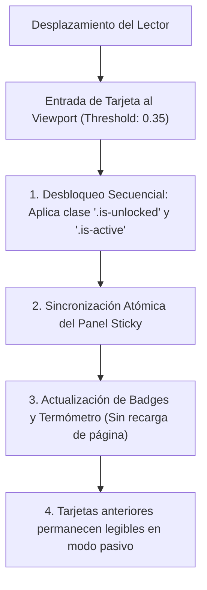

# 1. Contratos de Interfaz, Reactividad DOM y Frontend

> *«Los contratos de interfaz protegen la integridad técnica del sitio web: aseguran que ninguna modificación futura rompa la reactividad, la accesibilidad ni el flujo narrativo del Scrollytelling.»*

---

## 1.1. Invariantes del DOM y Elementos Críticos

Cualquier intervención sobre `index.html` debe preservar los siguientes identificadores y jerarquías estructurales:

| ID del Elemento | Rol Arquitectural | Invariante de Comportamiento |
| :--- | :--- | :--- |
| `#timeline` | Contenedor principal de la línea de tiempo | Debe renderizar las tarjetas en orden cronológico estricto según `anio_inicio`. |
| `.timeline-card` | Tarjeta individual de caso histórico | Debe contener los atributos de datos `data-id`, `data-year` y `data-gravity`. |
| `#stickyPanel` | Panel "Lente de la Deriva" (Sticky) | Debe permanecer fijo en el viewport durante el scroll del timeline. |
| `#currentYear` | Indicador del año enfocado | Debe actualizarse instantáneamente al entrar un nuevo caso al umbral visible. |
| `#overtonThermometer` | Barra visual de gravedad acumulada | Debe reflejar el valor máximo de gravedad alcanzado hasta el caso en foco. |
| `#overtonBadge` | Etiqueta de la etapa de normalización | Debe sincronizarse con el valor numérico del termómetro (Impensable $\rightarrow$ Normalizado). |

---

## 1.2. Contrato de Reactividad y Desbloqueo Secuencial

Para prevenir que el lector se abrume o que el panel de estado se sature de cálculos redundantes, se establece el siguiente contrato:

### Reglas Infranqueables:
1. **Preservación de Lectura de Casos Previos:**  
   Al desbloquearse un nuevo caso, las tarjetas de años anteriores **no deben ocultarse ni colapsar**, garantizando que el usuario pueda releer o consultar casos previos con total libertad.
2. **Cero Salto de Diseño (CLS = 0):**  
   La expansión de detalles o modales no debe provocar desplazamientos bruscos de la posición de scroll del lector (*Cumulative Layout Shift*).
3. **Aislamiento de Estado Global:**  
   El estado del Scrollytelling se gestiona en memoria sin contaminar variables del objeto global `window`, evitando colisiones con scripts de terceros.
