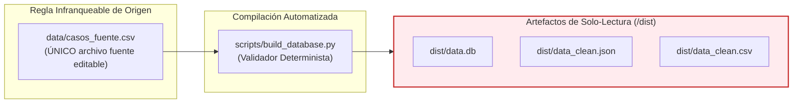
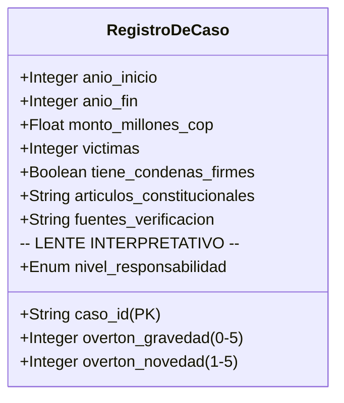

# 2. Contrato de Pipeline y Modelo de Datos (Data Integrity Contract)

> *«Los datos son el cimiento empírico de la obra. Un fallo de tipación o una inconsistencia relacional invalida la confianza en el análisis completo.»*

---

## 2.1. Invariantes Fundamentales de Datos

### Invariantes Obligatorios:
1. **Invariante de Único Origen de Verdad (SSOT):**  
   Queda estrictamente prohibido realizar commits que modifiquen de forma directa los archivos en `dist/` sin editar la fuente en `data/casos_fuente.csv`. Todo build debe ser **100% reproducible y determinista**.
2. **Inmutabilidad de la Clave Primaria (`caso_id`):**  
   Una vez publicado un caso con su identificador semántico (ej. `URB_YIDIS_01`), este ID **nunca debe renombrarse ni eliminarse**. Los enlaces permanentes y citas académicas externas dependen de su estabilidad.
3. **Validación Cruzada de Integridad Referencial:**  
   Todo número listado en la columna `articulos_constitucionales` debe existir de forma verificada en el catálogo maestro `data/articulos.json`. Si un caso referencia un artículo inexistente, el pipeline debe fallar de inmediato con código de salida 1.

---

## 2.2. Desacople Taxativo: Columnas Fácticas vs. Columnas Interpretativas

Para proteger el rigor científico del proyecto frente a acusaciones de sesgo, el modelo de datos impone una separación técnica irreversible:

- **Campos Fácticos Duros:**  
  Las columnas numéricas (`monto_millones_cop`, `victimas`) y booleanas (`tiene_condenas_firmes`) solo pueden albergar valores atómicos limpios (`FLOAT`, `INTEGER`, `BOOLEAN`), sin texto, adjetivos ni signos monetarios. Cualquier matiz explicativo debe confinarse a las columnas auxiliares de notas (`monto_detalles`, `victimas_detalles`, `condenas_detalles`).
- **Campos Analíticos de Overton:**  
  Las variables `overton_gravedad`, `overton_novedad` y `nivel_responsabilidad` reflejan exclusivamente el marco teórico del proyecto y no deben mezclarse con las cifras fácticas.

---

## 2.3. Criterios de Aceptación Automatizada del Pipeline

El script `scripts/build_database.py` actúa como compuerta de calidad ejecutando las siguientes pruebas en cada ejecución:
- [x] Patrón regex de `caso_id`: `^[A-Z]{3}_[A-Z0-9]+_\d{2}$`.
- [x] `anio_inicio` y `anio_fin` numéricos con $1990 \le \text{anio} \le 2026$.
- [x] `overton_gravedad` en el rango cerrado $[0, 5]$.
- [x] `overton_novedad` en el rango cerrado $[1, 5]$.
- [x] `nivel_responsabilidad` perteneciente al vocabulario controlado de 7 valores.
- [x] Integridad referencial con `data/articulos.json`.
