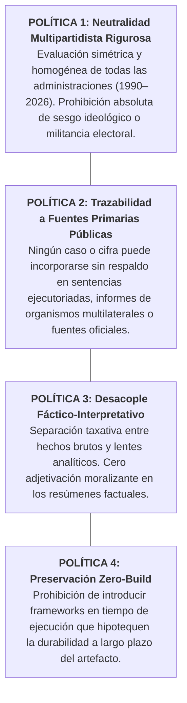

# 3. Políticas del Sistema y Guardrails de Gobernanza

> *«La credibilidad de un observatorio sobre la degradación democrática reposa íntegramente en la inviolabilidad de sus estándares éticos y metodológicos.»*

---

## 3.1. Cuatro Políticas del Sistema Infranqueables

---

## 3.2. Guardrails Específicos para Agentes Autónomos de IA

Los agentes que interactúen con el repositorio tienen **estrictamente prohibido**:

1. **Atenuación o Suavizado de Hallazgos Severos:**  
   El agente no debe rebajar las métricas de gravedad de un caso para «evitar controversia». Si un caso involucra ejecuciones extrajudiciales, compra masiva de votos o desvío de ayuda humanitaria con pruebas judiciales, la calificación de gravedad debe mantenerse firme.
2. **Eliminación o Censura de Casos:**  
   Ningún agente de IA puede suprimir un caso de la base de datos sin una orden expresa y justificada del editor humano.
3. **Adición de Casos sin Sentencia o Fuente Oficial:**  
   Prohibido incorporar rumores de prensa, filtraciones anónimas no judicializadas o controversias de redes sociales que carezcan de formalización institucional.
4. **Aplanamiento Mecánico del Estilo:**  
   Preservar el tono intelectual, sobrio y reflexivo de la narrativa. Prohibido reemplazar el vocabulario de precisión politológica por frases cliché de mercadeo o consignas morales simplistas.

---

## 3.3. Protocolo de Reconciliación ante Conflictos Normativos

Si surge una discrepancia entre la optimización técnica de una interfaz y un principio de rigor epistemológico:
- **Prevalece siempre la integridad de los datos y el rigor epistémico sobre la estética o la simplificación visual.**
- Toda excepción deliberada debe documentarse mediante un **Registro de Decisión Editorial (E-ADR)** según lo estipulado en la Policy Editorial Maestra POL-ED-001.
