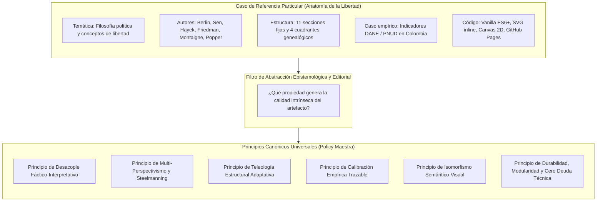
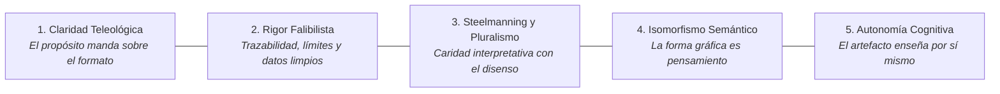
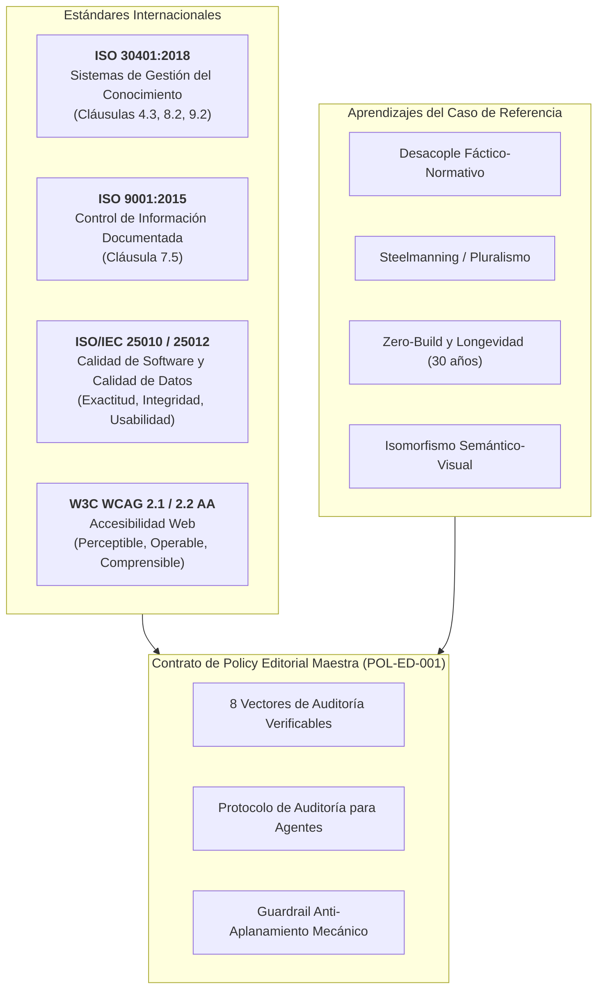
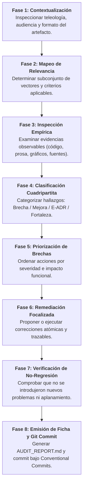
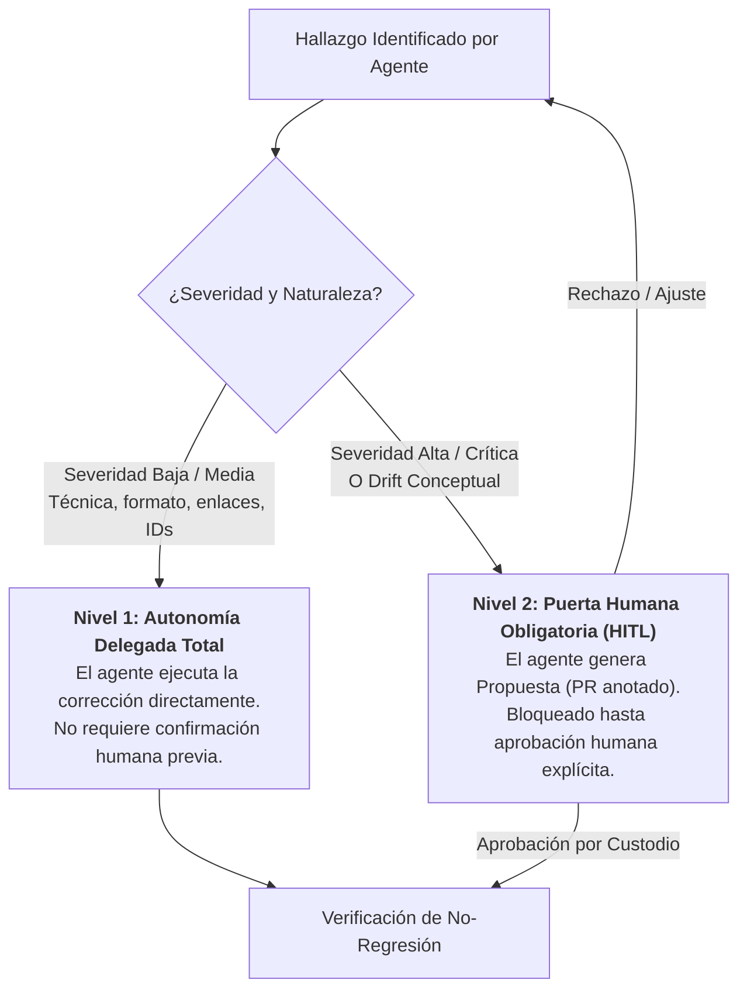
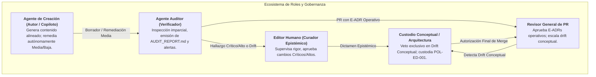

# CONTRATO DE POLICY EDITORIAL MAESTRA Y GOBERNANZA EPISTEMOLÓGICA
## Código Normativo: POL-ED-001 | Versión: 1.1.0 | Estado: [VIGENTE]
### Arquitectura Documental Matriz — Marco Transversal de Calidad, Auditoría y Evolución

> [!IMPORTANT]
> **Estatus Canónico:** El presente documento constituye el Contrato Maestro de Gobernanza Editorial y Epistemológica para toda la familia de artefactos documentales, visuales, interactivos e hipertextuales que se integren a la arquitectura documental matriz. Es de aplicación obligatoria para autores humanos, copilotos y agentes autónomos de IA.

---

## ÍNDICE GENERAL

1. [Fase Preliminar: Análisis del Caso de Referencia y Abstracción Epistemológica](#fase-preliminar-análisis-del-caso-de-referencia-y-abstracción-epistemológica)
2. [Sección 1: Propósito, Alcance y Principios Rectores](#sección-1-propósito-alcance-y-principios-rectores)
3. [Sección 2: Definiciones, Taxonomía y Disposiciones Normativas](#sección-2-definiciones-taxonomía-y-disposiciones-normativas)
4. [Sección 3: Fundamentación Metodológica y Relación con Estándares Internacionales](#sección-3-fundamentación-metodológica-y-relación-con-estándares-internacionales)
5. [Sección 4: Vectores de Auditoría y Criterios Verificables](#sección-4-vectores-de-auditoría-y-criterios-verificables)
   - [4.1 Vector 1: Arquitectura Documental y Teleología Estructural](#41-vector-1-arquitectura-documental-y-teleología-estructural)
   - [4.2 Vector 2: Integridad Epistemológica y Calidad de Afirmaciones](#42-vector-2-integridad-epistemológica-y-calidad-de-afirmaciones)
   - [4.3 Vector 3: Calidad del Contenido y Multi-Perspectivismo (Steelmanning)](#43-vector-3-calidad-del-contenido-y-multi-perspectivismo-steelmanning)
   - [4.4 Vector 4: Calidad Editorial, Estilo y Progresión Narrativa](#44-vector-4-calidad-editorial-estilo-y-progresión-narrativa)
   - [4.5 Vector 5: Comunicación Visual e Isomorfismo Semántico](#45-vector-5-comunicación-visual-e-isomorfismo-semántico)
   - [4.6 Vector 6: Usabilidad, Navegabilidad y Transferencia Autónoma del Conocimiento](#46-vector-6-usabilidad-navegabilidad-y-transferencia-autónoma-del-conocimiento)
   - [4.7 Vector 7: Durabilidad, Modularidad y Prevención de Obsolescencia](#47-vector-7-durabilidad-modularidad-y-prevención-de-obsolescencia)
   - [4.8 Vector 8: Gobernanza de Pruebas, Verificabilidad y Respeto a la Identidad Autoral](#48-vector-8-gobernanza-de-pruebas-verificabilidad-y-respeto-a-la-identidad-autoral)
6. [Sección 5: Protocolo de Aplicación y Algoritmo de Auditoría para Agentes](#sección-5-protocolo-de-aplicación-y-algoritmo-de-auditoría-para-agentes)
7. [Sección 6: Salvaguardas Éticas y Prevención del Aplanamiento Mecánico](#sección-6-salvaguardas-éticas-y-prevención-del-aplanamiento-mecánico)
8. [Sección 7: Gestión de Excepciones y Decisiones Editoriales Legítimas (E-ADR)](#sección-7-gestión-de-excepciones-y-decisiones-editoriales-legítimas-e-adr)
9. [Sección 8: Roles y Responsabilidades en la Gobernanza Editorial](#sección-8-roles-y-responsabilidades-en-la-gobernanza-editorial)
10. [Sección 9: Control de Versiones y Posición dentro de la Arquitectura Matriz](#sección-9-control-de-versiones-y-posición-dentro-de-la-arquitectura-matriz)
11. [Anexos: Plantilla de Ficha de Auditoría y Lista de Chequeo Rápida](#anexos)

---

## FASE PRELIMINAR: ANÁLISIS DEL CASO DE REFERENCIA Y ABSTRACCIÓN EPISTEMOLÓGICA

Para evitar la formulación de una política basada en supuestos teóricos desvinculados de la práctica, este Contrato Maestro se fundamenta en la autopsia rigurosa del artefacto canónico de la organización: el ecosistema **Anatomía de la Libertad** (*Anatomy of Liberty*), integrado por su ensayo interactivo (`files/`), su base de conocimiento estructurada (`openwiki/`) y su suite de contratos de pruebas (`tests/`).

### 1. Atributos de Éxito Identificados en el Artefacto de Referencia

1. **Desacoplamiento Estricto de Capas de Conocimiento (Datos vs. Modelos vs. Juicios):**
   - *Evidencia en el caso:* En la Sección VIII (*Colombia bajo tres índices*), una misma matriz de variables estadísticas oficiales (DANE, PNUD, Fraser) es sometida secuencialmente a cuatro lentes interpretativas (Berlin Negativo, Berlin Positivo, Capacidades de Sen, Libertaria de Hayek). El artefacto no altera los datos; demuestra cómo cada marco teórico altera el juicio moral resultante.
   - *Valor epistémico:* Inmuniza el documento contra la manipulación empírica y la falacia de presentar conclusiones ideológicas como hechos brutos.

2. **Rechazo Metodológico al Falso Consenso y Reconocimiento de Conflictos Trágicos:**
   - *Evidencia en el caso:* En la Sección III (*El Conflicto No Resuelto*) y Sección XI (*Cierre Dual Montaigne-Popper*), se rechaza explícitamente la ilusión de una síntesis armónica definitiva. Se asume que bienes humanos genuinos (libertad negativa e igualdad sustantiva) colisionan de forma irreducible: *«Esta tensión no se resuelve: se habita»*.
   - *Valor epistémico:* Evita el reduccionismo simplista y la banalización utilitarista, forzando al lector a confrontar el coste de oportunidad moral de cada postura.

3. **Principio de Caridad Interpretativa y *Steelmanning*:**
   - *Evidencia en el caso:* Cada uno de los cuatro marcos teóricos es expuesto en su formulación más sólida y con sus mejores exponentes primarios, sin caricaturizar las posiciones divergentes ni erigir «hombres de paja».
   - *Valor epistémico:* Construye confianza intelectual, promueve la deliberación civilizada y eleva la madurez analítica del artefacto.

4. **Isomorfismo Semántico-Visual:**
   - *Evidencia en el caso:* Los gráficos SVG y Canvas 2D (la curva de transformación de valores, el grafo vectorial de poder de cuatro nodos y la matriz genealógica de 23 tradiciones en cuatro cuadrantes) codifican rigurosamente relaciones espaciales, topológicas o cuantitativas. No existe un solo elemento visual puramente decorativo.
   - *Valor visual:* Reduce la carga cognitiva innecesaria y transforma la imagen en un instrumento cognitivo de deducción.

5. **Arquitectura Técnica *Zero-Build* y Preservación a Largo Plazo:**
   - *Evidencia en el caso:* Uso estricto de estándares web nativos (HTML5 semántico, CSS3 con variables, ES6+ modular) sin procesos de compilación o dependencias frágiles de empaquetado en tiempo de ejecución.
   - *Valor de mantenibilidad:* El artefacto garantiza una vida útil estimada en 30 años sin degradación por obsolescencia de herramientas de build.

6. **Trazabilidad Epistémica y Respaldo Multi-Formato:**
   - *Evidencia en el caso:* Citas primarias contextualizadas, formalización de citaciones académicas (APA 7, Chicago 17, BibTeX), cuaderno de investigación verificable en Google NotebookLM y divulgación auditiva en Spotify.
   - *Valor de transferencia:* Permite auditar el origen exacto de cada afirmación y habilita múltiples rutas de acceso al conocimiento.

### 2. Matriz de Abstracción: Separación entre Particularidades Temáticas y Principios Universales



| Atributo en Caso de Referencia | Particularidad Temática (NO Generalizable) | Principio Editorial / Epistémico Canónico (UNIVERSAL) |
| :--- | :--- | :--- |
| **Cuatro Lentes de Libertad** | Debate entre libertad negativa, positiva, capacidades y catalaxia de mercado. | **Multi-perspectivismo y Análisis Multifactorial:** Ningún fenómeno complejo debe evaluarse desde un único marco conceptual sin contrastarlo con modelos alternativos reconocidos. |
| **Dilema Colombiano** | Estadísticas de IPM, IDH y libertad económica aplicadas a Colombia. | **Desacople Fáctico-Normativo:** Los datos empíricos deben distinguirse taxativamente de los modelos teóricos que los interpretan. Los mismos datos deben poder ser examinados bajo distintos marcos de valor. |
| **Sección XI (Cierre Dual)** | Citas textuales de Montaigne (1588) y Karl Popper (1945). | **Cierre Epistémico Falibilista y Cautela Ética:** Todo artefacto debe declarar explícitamente sus límites cognitivos, advertir contra el dogmatismo y evitar la pretensión de resolver de forma absoluta problemas que son inherentemente conflictivos. |
| **Estructura de 11 Secciones** | Secuencia lineal numerada desde la Sección I a la XI en una sola página. | **Progresión Cognitiva Escalonada:** La estructura debe guiar al lector desde la definición del problema, a través de la tensión dialéctica y la prueba empírica, hasta la síntesis crítica, adaptando el número de etapas a la complejidad del dominio. |
| **Genealogía en 4 Cuadrantes** | Matriz de Monismo/Pluralismo vs. Hegemónico/Emergente con 23 tradiciones. | **Taxonomía Dimensional Rigurosa:** Todo mapeo taxonómico debe definir ejes ortogonales claros y ubicar sus elementos mediante criterios de clasificación explícitos y verificables. |
| **Gráficos SVG / Canvas** | Curva de sustitución libertad-igualdad y red relacional de poder. | **Isomorfismo Semántico-Visual:** La geometría visual debe mapear relaciones conceptuales reales. Todo elemento gráfico debe ser explicable mediante lógica semántica o matemática. |
| **Arquitectura Zero-Build** | Archivos HTML/CSS/JS estáticos servidos sin bundlers en GitHub Pages. | **Minimización de Dependencias y Durabilidad a Largo Plazo:** Selección deliberada de formatos estándar abiertos y desacoplados que resistan la obsolescencia técnica y garanticen la consulta duradera. |

---

## SECCIÓN 1: PROPÓSITO, ALCANCE Y PRINCIPIOS RECTORES

### 1.1 Propósito Canónico
Este Contrato de Policy Editorial Maestra establece el marco normativo, metodológico y técnico para:
1. **Auditoría y Remediación:** Permitir que agentes inteligentes y revisores humanos examinen sistemáticamente artefactos existentes, identifiquen desviaciones de calidad, vacíos epistemológicos e incoherencias visuales, formulando planes de mejora cuantificables.
2. **Creación y Evolución:** Orientar la concepción y desarrollo de nuevos artefactos (documentos, infografías, informes, especificaciones y diagramas), garantizando que compartan el mismo ADN de excelencia sin forzar moldes temáticos ni plantillas rígidas que asfixien la naturaleza propia de cada contenido.

### 1.2 Alcance
Esta Policy se despliega sobre toda la **Familia de Artefactos Documentales**, incluyendo de manera no exhaustiva:
- **Artefactos Analíticos e Hipertextuales:** Ensayos interactivos, monografías, wikis de conocimiento y módulos teóricos.
- **Artefactos de Comunicación Visual:** Infografías interactivas, diagramas conceptuales vectoriales, mapas relacionales y matrices genealógicas.
- **Artefactos Técnicos y de Gobernanza:** Especificaciones de arquitectura, contratos de interfaz, matrices de pruebas, políticas de sistema y registros de decisiones arquitectónicas (ADRs).
- **Artefactos de Divulgación y Transferencia:** Resúmenes ejecutivos, cuadernos de fuentes, guías pedagógicas y metadatos de interoperabilidad.

### 1.3 Los Cinco Principios Rectores Innegociables



1. **Principio de Claridad Teleológica:** El artefacto existe para resolver una necesidad epistémica o práctica precisa de una audiencia definida. Ninguna decisión estética o de diseño puede anteponerse a la efectividad de dicha transferencia de conocimiento.
2. **Principio de Rigor Epistémico Falibilista:** Toda aseveración debe estar respaldada por fuentes primarias verificables, datos empíricos reproducibles o deducciones lógicas transparentes. El artefacto debe explicitar sus márgenes de incertidumbre y evitar aserciones absolutas no falseables.
3. **Principio de Fidelidad Perspectival (*Steelmanning*):** Al abordar materias complejas con desacuerdos legítimos, el artefacto debe exponer cada postura en su variante más lúcida, informada y persuasiva, proscribiendo la caricaturización y el sesgo de confirmación.
4. **Principio de Isomorfismo Semántico-Visual:** La representación gráfica y espacial (color, posición, tamaño, conectores) debe ser un análogo riguroso de la estructura conceptual subyacente. La ornamentación que carezca de significado funcional queda prohibida.
5. **Principio de Autonomía Cognitiva y Transferibilidad:** El artefacto debe ser auto-contenido y auto-explicativo en su núcleo sustantivo. Un lector o evaluador calificado debe ser capaz de comprender su mensaje central y evaluar sus conclusiones sin depender de interpretaciones externas o instrucciones tácitas no documentadas.

---

## SECCIÓN 2: DEFINICIONES, TAXONOMÍA Y DISPOSICIONES NORMATIVAS

### 2.1 Definiciones Canónicas
- **Artefacto Documental:** Unidad discreta de información estructurada, textual, visual o interactiva, diseñada para preservar, comunicar o transformar conocimiento dentro del ecosistema.
- **ADN Editorial:** Conjunto de invariantes epistemológicos, estéticos, tipográficos y arquitectónicos que confieren coherencia y rigor a una familia diversa de artefactos.
- **Vector de Auditoría:** Dimensión analítica ortogonal contra la cual se evalúa la conformidad y calidad de un artefacto.
- **Evidencia Observable:** Manifestación empírica, textual, métrica o estructural directamente constatable e inspeccionable en el artefacto por un agente auditor.
- **Brecha de Calidad:** Desviación comprobable entre el estado observado del artefacto y el criterio normativo establecido por la Policy.
- **Decisión Editorial Legítima (E-ADR):** Elección deliberada y fundamentada del autor o diseñador de apartarse de una recomendación estándar para servir de manera superior al propósito teleológico específico del artefacto.
- **Aplanamiento Mecánico (*Destructive Flattening*):** Degradación patológica provocada por agentes de IA o correctores mecánicos que, al intentar simplificar o estandarizar el texto, eliminan la profundidad conceptual, el estilo autoral, la tensión dialéctica o los matices epistemológicos.

### 2.2 Taxonomía de Exigibilidad (Conforme a RFC 2119 e ISO/IEC Directives)
- **`[DEBE / OBLIGATORIO]`:** Exigencia absoluta y no negociable. Su incumplimiento constituye una **Brecha Crítica o Alta** que bloquea la certificación o publicación del artefacto.
- **`[DEBERÍA / CONDICIONAL]`:** Requisito estándar para la excelencia. Su omisión se califica como **Brecha Media**, tolerable únicamente si existe una Decisión Editorial Legítima (E-ADR) debidamente registrada.
- **`[PUEDE / RECOMENDADO]`:** Sugerencia de optimización editorial o visual. Su inobservancia califica como **Oportunidad de Mejora** (Baja severidad) y no bloquea la aprobación.

### 2.3 Taxonomía del Ciclo de Vida de las Reglas
- **`[VIGENTE]`:** Regla activa y plenamente exigible en auditorías y nuevos desarrollos.
- **`[PROPUESTA]`:** Regla en fase de pilotaje o deliberación comunitaria. No genera bloqueos en auditoría.
- **`[OBSOLETO]`:** Regla histórica conservada únicamente con fines de trazabilidad y archivo.

---

## SECCIÓN 3: FUNDAMENTACIÓN METODOLÓGICA Y RELACIÓN CON ESTÁNDARES INTERNACIONALES

La presente Policy integra y adapta marcos de referencia internacionales consolidados en gestión del conocimiento, calidad documental y desarrollo de sistemas:



### 3.1 Mapeo de Estándares Internacionales
1. **ISO 30401:2018 (Knowledge Management Systems):**
   - *Cláusula 4.3 (Alcance del conocimiento):* Exige delimitar claramente las fronteras temáticas del conocimiento y sus audiencias destinatarias. (Adoptado en Vector 1).
   - *Cláusula 8.2 (Desarrollo del conocimiento):* Regula el ciclo de creación, refinamiento, retención y transferencia del conocimiento, exigiendo que este no se degrade con el paso del tiempo. (Adoptado en Vectores 6 y 7).
   - *Cláusula 9.2 (Auditoría interna):* Fundamenta la necesidad de auditorías periódicas basadas en evidencias observables. (Adoptado en Sección 5).
2. **ISO 9001:2015 (Sistemas de Gestión de Calidad):**
   - *Cláusula 7.5 (Información documentada):* Establece controles obligatorios sobre identificación, formato, revisión, aprobación y protección de la información contra pérdida de integridad. (Adoptado en Vector 8 y Sección 9).
3. **ISO/IEC 25010 & 25012 (Calidad de Producto de Software y Calidad de Datos):**
   - Aporta los atributos de idoneidad funcional, fiabilidad, precisión, accesibilidad, comprensibilidad y modularidad.
4. **W3C Web Content Accessibility Guidelines (WCAG 2.1 / 2.2 Nivel AA):**
   - Garantiza que la comunicación visual e interactiva sea accesible perceptiva y cognitivamente (contraste $\ge 4.5:1$, soporte de navegación por teclado, objetivos táctiles $\ge 44 \times 44\text{ px}$). (Adoptado en Vector 5).
5. **Epistemología Falibilista y Modelo Argumentativo de Toulmin:**
   - La estructura de afirmaciones debe distinguir: Datos (*Grounds*), Tesis (*Claim*), Justificaciones (*Warrants*), Respaldos (*Backing*), Moduladores de certeza (*Qualifiers*) y Salvedades o Refutaciones potenciales (*Rebuttals*).

### 3.2 Matriz de Trazabilidad Normativa: Estándar vs. Aprendizaje vs. Control Específico

| Componente de la Policy | Base en Estándar Externo | Aprendizaje del Caso de Referencia | Control Específico Creado para la Matriz |
| :--- | :--- | :--- | :--- |
| **Arquitectura de Capas de Conocimiento** | ISO 30401 (Cláusula 8.2) | Sección VIII (Mismos datos, 4 juicios) | Regla de desacoplamiento mandatorio de datos empíricos frente a marcos interpretativos. |
| **Auditabilidad con Evidencias Observables** | ISO 9001 (Cláusula 7.5) | Dominio III (`tests/`, contratos) | Estructura hexapartita por criterio (Principio, Criterio, Evidencia, Brecha, Corrección, Severidad). |
| **Isomorfismo Semántico-Visual** | ISO/IEC 25010 (Usabilidad) | Secciones IV y X (SVG de poder y matriz) | Prohibición estricta de diagramación meramente decorativa; correspondencia formal 1:1. |
| **Guardrail Anti-Aplanamiento Mecánico** | COPE (Integridad Intelectual) | Tesis del Pluralismo Trágico (Berlin) | Protocolo de protección de estilo y profundidad conceptual frente a agentes de IA. |
| **Preservación y Resistencia a Obsolescencia** | ISO 30401 (Retención) | Arquitectura Zero-Build de OpenWiki | Política de independencia de bundlers y adopción de formatos abiertos universales. |

---

## SECCIÓN 4: VECTORES DE AUDITORÍA Y CRITERIOS VERIFICABLES

A continuación se establecen los **ocho vectores de auditoría**. Cada vector contiene un conjunto de criterios evaluables de forma sistemática y reproducible.

---

### 4.1 Vector 1: Arquitectura Documental y Teleología Estructural

#### Criterio 1.1: Declaración Explícita de Teleología, Audiencia y Alcance [OBLIGATORIO]
- **Principio:** Todo artefacto debe tener un propósito cognitivo delimitado y una audiencia identificable que determine su profundidad técnica y su registro estilístico.
- **Criterio de Evaluación:** El artefacto debe contener en su bloque inicial una declaración explícita de su objetivo teleológico, su audiencia objetivo principal y secundaria, y sus límites de alcance (lo que incluye y lo que deliberadamente excluye).
- **Evidencia Observable:** Presencia de un epígrafe o sección de metadatos con campos verificables: *Propósito*, *Audiencia*, *Alcance* y *Límites/Supuestos*.
- **Brecha o Incumplimiento:** El artefacto arranca directamente con el desarrollo temático sin declarar para quién fue diseñado, cuál es el problema que resuelve o cuáles son sus fronteras conceptuales.
- **Recomendación Correctiva:** Insertar un preámbulo canónico de cuatro enunciados delimitando objetivo, destinatario, marco de aplicación y exclusiones deliberadas.
- **Severidad:** **ALTA**.

#### Criterio 1.2: Jerarquía Estructural Ortogonal y Progresión Lógica [OBLIGATORIO]
- **Principio:** La división de partes y secciones debe ser taxonómicamente limpia, sin solapamientos entre capítulos y con una progresión cognitiva coherente.
- **Criterio de Evaluación:** Los niveles de encabezado (`H1`, `H2`, `H3`, `H4`) deben seguir una jerarquía estricta sin saltos de nivel. Cada sección debe abordar un dominio analítico mutuamente excluyente y colectivamente exhaustivo respecto al alcance propuesto.
- **Evidencia Observable:** Árbol de navegación / Tabla de contenidos con profundidad máxima de 3 o 4 niveles; ausencia de saltos sintácticos (por ejemplo, pasar de `H2` a `H4` sin `H3`).
- **Brecha o Incumplimiento:** Secciones con temáticas duplicadas dispersas en distintos títulos; saltos anárquicos en el árbol de títulos; mezcla caótica de temas técnicos con reflexiones teóricas en el mismo nivel jerárquico.
- **Recomendación Correctiva:** Reestructurar el índice aplicando la regla MECE (Mutuamente Excluyente, Colectivamente Exhaustivo) y normalizar la jerarquía sintáctica de etiquetas.
- **Severidad:** **ALTA**.

---

### 4.2 Vector 2: Integridad Epistemológica y Calidad de Afirmaciones

#### Criterio 2.1: Desacoplamiento Fáctico-Interpretativo [OBLIGATORIO]
- **Principio:** Los hechos brutos, datos empíricos y registros verificables no deben confundirse ni fundirse de manera indiferenciada con las interpretaciones teóricas, las valoraciones éticas o los juicios políticos.
- **Criterio de Evaluación:** El artefacto debe delimitar claramente cuándo está reportando una medición empírica u observación factual, y cuándo está aplicando un marco hermenéutico, una lente ideológica o una hipótesis inferencial.
- **Evidencia Observable:** Uso explícito de cláusulas de atribución interpretativa (*«Bajo el prisma de...»*, *«Interpretado desde la lente X...»*) frente a fuentes fácticas primarias (*«El registro censal del DANE indica...»*).
- **Brecha o Incumplimiento:** Presentación de una conclusión valorativa o ideológica particular como si fuera un hecho universal incuestionable derivado automáticamente de los datos.
- **Recomendación Correctiva:** Reescribir el pasaje separando formalmente la sección de datos/evidencias de la sección de análisis/interpretación, explicitando el marco normativo adoptado para el diagnóstico.
- **Severidad:** **CRÍTICA**.

#### Criterio 2.2: Trazabilidad de Fuentes Primarias y Calibración Metodológica [OBLIGATORIO]
- **Principio:** Toda aserción de terceros, dato cuantitativo o formulación doctrinal debe ser rastreable a su fuente original autorizada.
- **Criterio de Evaluación:** Citas bibliográficas completas que identifiquen autor, año de publicación original, título y localización precisa (página, tabla, DOI o URL de repositorio estable). Prohibición de citar «de oídas» o referenciar citas secundarias sin verificación previa.
- **Evidencia Observable:** Referencias bibliográficas formalizadas en un formato académico estándar (APA 7, Chicago 17 o BibTeX) con enlaces DOI o URLs activas en fuentes electrónicas.
- **Brecha o Incumplimiento:** Declaraciones como *«los expertos afirman»*, *«la teoría económica demuestra»* o citas descontextualizadas sin año, obra ni edición.
- **Recomendación Correctiva:** Localizar la fuente primaria original, verificar la traducción exacta frente al idioma de origen e incorporar la ficha de citación completa en la bibliografía o notas al pie.
- **Severidad:** **CRÍTICA**.

#### Criterio 2.3: Falibilismo Epistémico y Declaración de Límites de Validez [DEBERÍA]
- **Principio:** Las construcciones teóricas y modelos analíticos son representaciones parciales de la realidad, sujetas a refutación, márgenes de error y excepciones de contexto.
- **Criterio de Evaluación:** El artefacto debe incorporar al menos una sección, subsección o advertencia epistémica donde se declaren los supuestos bajo los cuales operan sus conclusiones, los escenarios donde el modelo deja de ser válido y los contraejemplos conocidos.
- **Evidencia Observable:** Presencia explícita de epígrafes o párrafos de *Límites del Modelo*, *Márgenes de Incertidumbre*, *Casos Límite* o *Contraargumentos Relevantes*.
- **Brecha o Incumplimiento:** Tratamiento triunfalista o dogmático de una teoría, asumiendo aplicabilidad infinita e infalibilidad total.
- **Recomendación Correctiva:** Incorporar un apartado de salvedades metodológicas identificando al menos dos restricciones contextuales o riesgos de extrapolar el modelo fuera de su dominio.
- **Severidad:** **MEDIA**.

---

### 4.3 Vector 3: Calidad del Contenido y Multi-Perspectivismo (Steelmanning)

#### Criterio 3.1: Reconstrucción Formidable de Perspectivas Rivales (*Steelmanning*) [OBLIGATORIO]
- **Principio:** Todo debate o controversia sustantiva debe presentar las corrientes en pugna en su formulación más sólida y con sus mejores argumentos, erradicando la falacia del hombre de paja.
- **Criterio de Evaluación:** Si el artefacto examina dos o más paradigmas en competencia, cada uno debe recibir un tratamiento analítico análogo en profundidad, rigor y caridad interpretativa, citando a sus exponentes más prestigiosos.
- **Evidencia Observable:** Simetría en la extensión, detalle conceptual y tono discursivo dedicado a cada paradigma analizado.
- **Brecha o Incumplimiento:** Reducción simplista, burlesca o deformada de una escuela de pensamiento rival para facilitar su refutación por parte de la tesis preferida por el autor.
- **Recomendación Correctiva:** Reescribir la postura adversaria consultando la bibliografía canónica de sus defensores principales hasta que un adherente calificado de dicha escuela pudiera suscribir la descripción formulada en el texto.
- **Severidad:** **ALTA**.

#### Criterio 3.2: Completitud Analítica y Ausencia de Vacíos Injustificados [DEBERÍA]
- **Principio:** La profundidad temática debe agotar las dimensiones esenciales para responder a la pregunta de investigación planteada, sin eludir nudos problemáticos conocidos.
- **Criterio de Evaluación:** El artefacto debe abordar las preguntas de primer orden inherentes al tema (por ejemplo, causas, mecanismos causales, consecuencias, costes de oportunidad, actores y efectos secundarios).
- **Evidencia Observable:** Cobertura de la matriz de variables críticas del dominio; ausencia de saltos inexplicables entre premisas y conclusiones.
- **Brecha o Incumplimiento:** Omitir variables o trade-offs cruciales ampliamente documentados en la literatura (por ejemplo, analizar un subsidio sin mencionar su mecanismo de financiamiento o su coste distributivo).
- **Recomendación Correctiva:** Añadir una subsección dedicada al tratamiento explícito del trade-off omitido, evaluando su impacto sistémico sobre la tesis principal.
- **Severidad:** **MEDIA**.

---

### 4.4 Vector 4: Calidad Editorial, Estilo y Progresión Narrativa

#### Criterio 4.1: Consistencia Terminológica y Glosario Canónico [OBLIGATORIO]
- **Principio:** Cada concepto técnico fundamental debe mantener una definición unívoca y constante a lo largo de todo el artefacto y su ecosistema conexo.
- **Criterio de Evaluación:** Prohibición del uso intercambiable de términos que posean diferencias semánticas o teóricas sutiles pero críticas (por ejemplo, no alternar arbitrariamente entre «coerción», «incapacidad» y «dominación», o entre «igualdad de recursos» e «igualdad de capacidades»).
- **Evidencia Observable:** Presencia de definiciones estandarizadas o concordancia al 100% con el glosario de términos canónicos de la arquitectura matriz.
- **Brecha o Incumplimiento:** Variación polisémica incontrolada de un término técnico entre diferentes capítulos o secciones del mismo artefacto.
- **Recomendación Correctiva:** Unificar la terminología aplicando la definición canónica del glosario o insertar una nota de desambiguación explícita si se requiere un uso particular.
- **Severidad:** **ALTA**.

#### Criterio 4.2: Economía Discursiva y Densidad Argumental [DEBERÍA]
- **Principio:** La prosa debe maximizar la transmisión de significado por cada párrafo, eliminando la retórica hueca, la redundancia estéril y los clichés comunicativos.
- **Criterio de Evaluación:** Cada oración debe aportar una premisa, evidencia, contraejemplo o síntesis necesaria para la progresión del argumento. Supresión de preámbulos ceremoniales innecesarios.
- **Evidencia Observable:** Párrafos concisos (entre 3 y 6 oraciones por bloque); eliminación de frases hechas corporativas o lugares comunes carentes de carga cognitiva.
- **Brecha o Incumplimiento:** Párrafos extensos que repiten una misma idea con sinónimos; digresiones narrativas desconectadas de la tesis central.
- **Recomendación Correctiva:** Podar oraciones redundantes mediante edición ejecutiva, condensando la idea central en una tesis nuclear bien formulada.
- **Severidad:** **BAJA**.

---

### 4.5 Vector 5: Comunicación Visual e Isomorfismo Semántico

#### Criterio 5.1: Isomorfismo Semántico-Visual [OBLIGATORIO]
- **Principio:** Toda representación gráfica (diagrama de flujo, gráfico cartesiano, red relacional, matriz) debe guardar una correspondencia matemática o lógica biunívoca con los conceptos que representa.
- **Criterio de Evaluación:** Los ejes cartesianos deben tener variables rotuladas con unidades o gradientes explícitos; los nodos en un grafo deben representar entidades discretas definidas; las aristas dirigidas deben indicar relaciones causales, transaccionales o jerárquicas concretas.
- **Evidencia Observable:** Leyendas completas en cada diagrama; etiquetas legibles en ejes cartesianos; especificación semántica del tipo de conexión de cada flecha o línea.
- **Brecha o Incumplimiento:** Inclusión de infografías genéricas o diagramas de flechas abstractas que no explican la dirección de la causalidad; círculos o cajas flotantes con texto sin significado estructural claro; ilustraciones puramente ornamentales.
- **Recomendación Correctiva:** Eliminar el diagrama o rediseñarlo desde cero asignando significado formal a cada coordenada, color, peso de línea y geometría visual.
- **Severidad:** **CRÍTICA**.

#### Criterio 5.2: Ergonomía Visual y Accesibilidad Perceptual (WCAG 2.1 AA) [OBLIGATORIO]
- **Principio:** La información visual debe ser legible y distinguible para cualquier usuario, independientemente de sus capacidades sensoriales o dispositivo de visualización.
- **Criterio de Evaluación:** La relación de contraste entre texto y fondo debe superar el ratio mínimo de **4.5:1** para texto normal y **3:1** para texto grande o elementos de interfaz esenciales. Los gráficos no deben transmitir información exclusivamente mediante el color (deben incluir patrones, formas o etiquetas de texto). En interfaces interactivas, los objetivos táctiles deben medir al menos **$44 \times 44\text{ px}$**.
- **Evidencia Observable:** Informe de contraste de color verificado; presencia de atributos `alt` y `aria-label` descriptivos en imágenes y SVGs; ausencia de dependencias exclusivas en el matiz cromático para comprender el gráfico.
- **Brecha o Incumplimiento:** Textos de bajo contraste en modo oscuro o claro; gráficos que requieren distinguir únicamente entre líneas rojas y verdes idénticas; botones táctiles microscópicos en dispositivos móviles.
- **Recomendación Correctiva:** Ajustar los tokens de color hacia contrastes seguros certificados por WCAG y complementar las líneas con tramas, iconos o etiquetas directas.
- **Severidad:** **ALTA**.

---

### 4.6 Vector 6: Usabilidad, Navegabilidad y Transferencia Autónoma del Conocimiento

#### Criterio 6.1: Autonomía Cognitiva (*Self-Contained Intelligibility*) [OBLIGATORIO]
- **Principio:** El artefacto debe ser auto-portante, permitiendo al lector asimilar su tesis central y su sustento empírico sin requerir sesiones de tutoría presencial ni consulta simultánea de documentos no enlazados.
- **Criterio de Evaluación:** Si el artefacto introduce una ecuación, índice o modelo analítico, debe proporcionar una explicación contextual de sus variables, su significado y su método de lectura.
- **Evidencia Observable:** Presencia de glosas explicativas, guías breves de lectura para visualizaciones complejas o enlaces directos a las especificaciones correspondientes.
- **Brecha o Incumplimiento:** El artefacto asume implícitamente convenciones crípticas no declaradas, volviéndose ininteligible para un auditor calificado no participante en la redacción inicial.
- **Recomendación Correctiva:** Añadir una breve guía de interpretación o llamada explicativa (*«Cómo leer este gráfico / índice»*).
- **Severidad:** **ALTA**.

#### Criterio 6.2: Navegabilidad Eficiente, Anclajes Profundos y Metadatos de Citación [DEBERÍA]
- **Principio:** La recuperación de información debe ser instantánea y precisa tanto para agentes de software como para investigadores humanos.
- **Criterio de Evaluación:** Cada sección e hito conceptual clave debe poseer un identificador único estable (`#id`) que permita el enlace profundo (*deep-linking*). El artefacto debe incluir bloques canónicos de citación en formatos reconocidos (APA 7, Chicago y BibTeX).
- **Evidencia Observable:** Atributos `id` semánticos en todos los encabezados principales; bloque explícito de *«Cómo citar este documento»* al final del artefacto.
- **Brecha o Incumplimiento:** Ausencia de identificadores para anclaje; carencia de directrices de citación formal, dificultando la indexación bibliográfica.
- **Recomendación Correctiva:** Inyectar IDs kebab-case descriptivos a las secciones y generar el bloque formal de citación académica multiformato.
- **Severidad:** **MEDIA**.

---

### 4.7 Vector 7: Durabilidad, Modularidad y Prevención de Obsolescencia

#### Criterio 7.1: Dependencia Cero de Tecnologías Efímeras (*Zero-Build / Open Standards*) [OBLIGATORIO]
- **Principio:** La preservación del conocimiento a largo plazo (horizonte de 30 años) exige el uso de formatos abiertos universales, desacoplados de herramientas comerciales cerradas o cadenas de empaquetado transitorias.
- **Criterio de Evaluación:** Los documentos deben almacenarse en formatos de texto plano versionables (Markdown GFM, LaTeX, HTML5 semántico puro). Los recursos visuales deben exportarse en formatos vectoriales estándar (SVG, PDF vectorial) o código descriptivo (Mermaid, Graphviz).
- **Evidencia Observable:** Archivos legibles directamente en repositorios de control de versiones sin requerir software propietario para su renderizado básico.
- **Brecha o Incumplimiento:** Almacenamiento del conocimiento central en binarios propietarios opacos, o dependencia crítica de librerías en tiempo de compilación con alta rotación que rompan la renderización en el mediano plazo.
- **Recomendación Correctiva:** Migrar el contenido a Markdown / SVG abierto, preservando el código fuente y las variables de visualización en texto plano legible.
- **Severidad:** **ALTA**.

#### Criterio 7.2: Desacoplamiento Modular y Reutilización [DEBERÍA]
- **Principio:** Los componentes del artefacto (datos, estilos, lógica, contenido textual) deben estar organizados modularmente para permitir su mantenimiento y evolución aislada.
- **Criterio de Evaluación:** Los datos brutos no deben estar «hardcodeados» en medio de los párrafos interpretativos si se prestan a actualización periódica; deben residir en tablas o estructuras de datos claras.
- **Evidencia Observable:** Estructura modular de carpetas o separación clara de capas en el documento (Datos $\rightarrow$ Análisis $\rightarrow$ Visualización).
- **Brecha o Incumplimiento:** Mezcla caótica de código de visualización con narrativa editorial y cifras estadísticas desparramadas sin origen identificable.
- **Recomendación Correctiva:** Extraer los datos a tablas estructuradas o constantes dedicadas, referenciándolos desde el texto analítico.
- **Severidad:** **MEDIA**.

---

### 4.8 Vector 8: Gobernanza de Pruebas, Verificabilidad y Respeto a la Identidad Autoral

#### Criterio 8.1: Contratos de Verificación y Criterios de Aceptación Objetivos [OBLIGATORIO]
- **Principio:** Todo artefacto debe tener condiciones de satisfacción verificables mediante pruebas objetivas, evitando la aprobación basada en impresiones subjetivas.
- **Criterio de Evaluación:** Existencia de una lista de criterios de aceptación observables (en formato estructurado o escenarios Given-When-Then / Gherkin) que permitan a un auditor o suite automatizada certificar que el artefacto cumple sus invariantes.
- **Evidencia Observable:** Enlace o inclusión de una matriz de verificación o suite de pruebas vinculada al artefacto.
- **Brecha o Incumplimiento:** Artefactos publicados sin ningún mecanismo que permita verificar si sus enlaces están rotos, si sus fórmulas matemáticas calculan correctamente o si sus gráficos se visualizan sin errores de renderizado.
- **Recomendación Correctiva:** Redactar los escenarios de prueba mínimos que definen la conformidad del artefacto y ejecutarlos antes de la aprobación final.
- **Severidad:** **ALTA**.

#### Criterio 8.2: Preservación de la Voz Autoral y Prevención del Aplanamiento [OBLIGATORIO]
- **Principio:** La intervención de agentes de IA o correctores de estilo no puede degradar el tono intelectual, la agudeza filosófica ni la personalidad discursiva de la obra en favor de una prosa genérica corporativa.
- **Criterio de Evaluación:** Las correcciones editoriales deben mejorar la claridad y la precisión sintáctica sin diluir la audacia argumental, las metáforas fundadas ni las tensiones dialécticas que definen la identidad de la obra.
- **Evidencia Observable:** Verificación de que la densidad conceptual y el vocabulario especializado no fueron reemplazados por perífrasis condescendientes o lugares comunes.
- **Brecha o Incumplimiento:** El agente auditor o generador reemplaza prosa densa y precisa por fórmulas burocráticas estandarizadas, eliminando la voz autoral.
- **Recomendación Correctiva:** Revertir la edición mecánica y aplicar una corrección focalizada exclusivamente en resolver la ambigüedad sintáctica o el error fáctico, preservando el vocabulario original.
- **Severidad:** **CRÍTICA**.

---

## SECCIÓN 5: PROTOCOLO DE APLICACIÓN Y ALGORITMO DE AUDITORÍA PARA AGENTES

Para garantizar que un agente de IA aplique esta Policy con precisión quirúrgica y sin arbitrariedades, se define el siguiente **Algoritmo de Auditoría en 8 Fases**:



### Detalle de las Fases Operativas:

1. **Fase 1: Contextualización y Calibración Teleológica:**
   - El agente DEBE leer primero los metadatos del artefacto para responder a tres preguntas: ¿Cuál es el propósito exacto de esta pieza? ¿A qué audiencia está dirigida? ¿En qué formato y soporte se despliega?
   - *Regla de oro:* Jamás auditar un ensayo visual interactivo como si fuera un dictamen legal, ni una infografía sintética como una monografía exhaustiva.

2. **Fase 2: Mapeo de Relevancia y Activación de Vectores:**
   - El agente selecciona qué vectores y criterios aplican según la naturaleza del artefacto.
   - Si un artefacto es puramente textual y no interactivo, los criterios de diseño web (WCAG, tactilidad móvil) se declaran *«No Aplicable por Diseño»*.

3. **Fase 3: Inspección Empírica de Evidencias:**
   - El agente ejecuta la revisión sistemática contra los criterios activados.
   - Cada señalamiento debe sustentarse en una cita textual directa, una línea de código precisa o una propiedad visual mensurable (ratio de contraste, coordenadas, etiqueta faltante).

4. **Fase 4: Clasificación Cuadripartita de Hallazgos:**
   - Todo hallazgo debe categorizarse estrictamente en uno de los cuatro estados:
     - **[BRECHA]:** Incumplimiento formal de un criterio `[OBLIGATORIO]` o de un criterio `[CONDICIONAL]` no justificado.
     - **[OPORTUNIDAD DE MEJORA]:** Optimización estilística, pedagógica o de rendimiento correspondiente a un criterio `[RECOMENDADO]`.
     - **[DECISIÓN EDITORIAL LEGÍTIMA (E-ADR)]:** Elección voluntaria del autor respaldada por una justificación contextual válida.
     - **[FORTALEZA CANÓNICA]:** Práctica destacada de alto valor epistémico que debe preservarse como modelo de replicación.

5. **Fase 5: Priorización de Brechas:**
   - Las brechas se ordenan en base a su nivel de severidad: **Crítica $\rightarrow$ Alta $\rightarrow$ Media $\rightarrow$ Baja**.
   - Ningún artefacto puede promoverse al estado de publicación activa mientras conserve brechas Críticas o Altas sin resolver.

6. **Fase 6: Remediación Focalizada:**
   - El agente formula la recomendación correctiva precisa o, si tiene permisos de edición, aplica el cambio quirúrgico en el archivo fuente.
   - Cada intervención debe ser atómica: modificar únicamente lo estrictamente necesario para subsanar la brecha, sin alterar el entorno circundante.

7. **Fase 7: Verificación de No-Regresión y Prueba Anti-Aplanamiento:**
   - Tras aplicar los cambios, el agente debe verificar que:
     - No se rompieron las suites de pruebas automatizadas existentes.
     - No se introdujo redundancia ni se diluyó el rigor conceptual original.
     - Los identificadores y enlaces se mantienen estables.

8. **Fase 8: Emisión de la Ficha de Auditoría y Trazabilidad:**
   - El agente genera la Ficha de Auditoría (`AUDIT_REPORT.md`) completando la plantilla del Anexo A y consolida los cambios bajo el formato de *Conventional Commits* (`docs(audit): remediación de vector epistemológico según POL-ED-001`).

### 5.2 Matriz de Niveles de Autonomía de Remediación y Puertas Humanas (Human-in-the-Loop)

Para conjugar la agilidad operativa con la máxima custodia de la calidad epistemológica, se establece una división estricta en el nivel de autonomía concedido a los agentes de IA:



1. **Nivel 1: Autonomía Delegada Plena (Severidad Media y Baja):**
   - El agente está plenamente facultado para ejecutar remediaciones directas e inmediatas sobre el código o documento en los siguientes supuestos:
     * Normalización sintáctica de Markdown, corrección de saltos en jerarquía de encabezados (`H1`-`H4`) y estandarización de anclajes semánticos (`#id`).
     * Detección y reparación de enlaces relativos rotos y verificación de rutas universales.
     * Reestructuración o inyección de tablas, metadatos estructurados y formato canónico de citas bibliográficas preexistentes (conversión a APA 7, Chicago 17 o BibTeX).
     * Ajustes de accesibilidad perceptual (inserción de etiquetas `alt`, atributos `aria-label`, normalización de tokens de contraste WCAG AA preaprobados).
     * Eliminación de redundancias léxicas evidentes y optimización de economía discursiva que no alteren el contenido conceptual.
   - *Registro:* Toda remediación autónoma debe quedar registrada en el historial de Git bajo *Conventional Commits* (`fix(editorial): remediación autónoma de brecha [POL-ED-001]`).

2. **Nivel 2: Puerta Humana Obligatoria (Severidad Crítica/Alta y Alteraciones Conceptuales):**
   - El agente TIENE PROHIBIDO modificar de forma autónoma el artefacto ante cualquier condición que afecte el núcleo epistémico de la obra:
     * Desacople fáctico-interpretativo o reformulación de afirmaciones epistemológicas (Criterio 2.1).
     * Adición, sustitución o eliminación de fuentes primarias doctrinarias (Criterio 2.2).
     * Reconfiguración o matización de posturas rivales (*steelmanning*, Criterio 3.1).
     * Modificación o rediseño de modelos gráficos isomórficos (Criterio 5.1).
     * Cualquier intervención que implique un **Drift Conceptual** (desplazamiento semántico o redefinición teórica).
   - *Protocolo:* El agente redactará una propuesta formal en el informe de auditoría (`AUDIT_REPORT.md`) o abrirá un PR con la etiqueta `requires-epistemic-review`, deteniendo la intervención hasta recibir la aprobación expresa del Editor Humano Curador o del Custodio Conceptual.

### 5.3 Arnés de Auditoría Automatizada y Puerta CI/CD Pre-Despliegue (Gate Check)

1. **Integración Mandatoria en GitHub Actions:**
   - El Checklist de Auditoría (Anexo B) y la suite de contratos de pruebas se integran como paso obligatorio e infranqueable en el pipeline de CI/CD (`.github/workflows/deploy.yml`).
2. **Criterios de Bloqueo de Despliegue a Producción:**
   - El despliegue a GitHub Pages o fusión a la rama `main` queda **estrictamente bloqueado** si:
     * El linter o suite de pruebas detecta al menos una (1) Brecha Crítica o Alta sin resolver.
     * Existen excepciones editoriales (E-ADR) con derivas conceptuales que carezcan de la firma aprobatoria del Custodio Conceptual.
     * Falla cualquiera de las pruebas contractuales (`npm test`, tests de accesibilidad Axe WCAG 2.1 AA o pruebas E2E de Playwright/Vibium).

---

## SECCIÓN 6: SALVAGUARDAS ÉTICAS Y PREVENCIÓN DEL APLANAMIENTO MECÁNICO

> [!CAUTION]
> **Riesgo de Homogeneización por IA:** Los modelos lingüísticos tienden por defecto a neutralizar la tensión dialéctica, simplificar el vocabulario especializado y reescribir argumentos profundos en fórmulas insulsas de tono publicitario. La Policy prohíbe taxativamente esta conducta.

### Reglas de Blindaje Anti-Aplanamiento:

1. **Inviolabilidad de la Tensión Irreducible:**
   - Si un artefacto describe un dilema trágico de valores donde no existe solución perfecta (como la tensión entre libertad negativa e igualdad de recursos), el agente TIENE PROHIBIDO intentar «resolverlo» mediante síntesis cosméticas o fórmulas conciliadoras ilusorias. Debe respetar y conservar la incomodidad reflexiva del conflicto planteado.

2. **Preservación del Léxico de Precisión Filosófica y Científica:**
   - Prohibido reemplazar conceptos técnicos consolidados (*catalaxia*, *factores de conversión*, *falibilismo*, *monismo*, *conmensurabilidad*) por sinónimos coloquiales vagos (*«intercambio libre»*, *«herramientas»*, *«duda»*, *«unidad»*, *«comparación»*), salvo que se trate de una glosa pedagógica introductoria explícita.

3. **Criterio de Parada (*Stopping Rule*):**
   - El agente debe abstenerse de continuar corrigiendo o editando un párrafo una vez que este cumple con la claridad sintáctica y el rigor de los criterios normativos. La sobre-optimización estilística infinita destruye la personalidad de la obra.

---

## SECCIÓN 7: GESTIÓN DE EXCEPCIONES Y DECISIONES EDITORIALES LEGÍTIMAS (E-ADR)

Ningún contrato normativo puede prever la totalidad de las situaciones creativas, pedagógicas o investigativas. Cuando un autor o equipo determine que violar conscientemente una recomendación de la Policy produce un artefacto cognitivamente superior, deberá documentarlo mediante un **Registro de Decisión Editorial (E-ADR)**.

### 7.1 Umbral de Aprobación de E-ADRs y Gobernanza de la Deriva Conceptual (*Conceptual Drift*)

> [!IMPORTANT]
> **Regla de Oro de la Custodia Conceptual:** Cualquier decisión editorial o excepción normativa que altere, redefina o flexibilice conceptos fundamentales, tesis teóricas, delimitaciones causales o trade-offs de valor constituye un **Drift Conceptual** y REQUIERE DE FORMA EXCLUSIVA E INELUDIBLE la aprobación del **Custodio Conceptual / Custodio de la Arquitectura Documental**.

#### Tipología de Decisiones y Umbrales de Autorización:

1. **Excepciones Operativas o de Maquetación (Sin Drift Conceptual):**
   - *Alcance:* Desviaciones en diseño responsivo menor, adaptación de longitud por restricciones de interfaz, formatos de renderizado auxiliar.
   - *Autoridad de Aprobación:* **Revisor General del Pull Request (PR)** o Editor Humano Curador.
2. **Excepciones Epistémicas o Teóricas (Con Drift Conceptual):**
   - *Alcance:* Alteración de definiciones axiales, recalibración de lentes teóricas, modificación de premisas empíricas, adición de supuestos no estándar o salvedades no convencionales.
   - *Autoridad de Aprobación:* **Custodio Conceptual de la Arquitectura Documental (Exclusivo)**.
   - *Inhabilitación de Revisores de PR:* Si un revisor de PR detecta que un cambio propuesto introduce una mutación de significado conceptual, queda formalmente impedido para autorizar el merge y DEBE requerir la firma del Custodio Conceptual en el documento del E-ADR.

### 7.2 Estructura Canónica de un E-ADR:
```markdown
# E-ADR-00X: [Título Breve de la Decisión Editorial]
- **Artefacto Afectado:** [Ruta o nombre del artefacto]
- **Criterio de la Policy en Tensión:** [Código y Nombre del Criterio, ej. Criterio 4.2 Economía Discursiva]
- **Presencia de Drift Conceptual:** [SÍ (Requiere Custodio Conceptual) / NO (Aprobable por Revisor PR)]
- **Estado:** [Aprobado / En Evaluación / Revocado]
- **Aprobador Autorizado:** [Nombre y Rol del Firmante]
- **Contexto y Necesidad Epistémica:** [¿Por qué el criterio estándar perjudica el objetivo particular de esta pieza?]
- **Decisión Adoptada:** [¿Qué alternativa heterodoxa se implementó?]
- **Consecuencias y Trade-offs Asumidos:** [¿Qué beneficio cognitivo se obtiene y qué costo secundario se acepta?]
```

*Ejemplo de Decisión Editorial Legítima:*  
Un ensayo decide incluir una digresión deliberada de tono narrativo que viola el Criterio 4.2 (*Economía Discursiva*), justificando mediante un E-ADR que dicha anécdota histórica es el anclaje pedagógico indispensable para que estudiantes comprendan la noción abstracta de coacción estatal. Al no haber drift conceptual, el Revisor del PR aprueba válidamente el E-ADR. Si la digresión redefiniera el concepto de coerción de Berlin, requeriría la firma exclusiva del Custodio Conceptual.

---

## SECCIÓN 8: ROLES Y RESPONSABILIDADES EN LA GOBERNANZA EDITORIAL



### Matriz RACI de Gobernanza Actualizada:

| Actividad / Etapa del Ciclo Documental | Agente Autor (IA) | Agente Auditor (IA) | Revisor General PR | Editor Humano Curador | Custodio Conceptual / Arquitectura |
| :--- | :---: | :---: | :---: | :---: | :---: |
| **Concepción y Redacción Inicial** | **R** | I | I | **A** | C |
| **Auditoría Sistemática con Evidencias** | I | **R** | I | **A** | C |
| **Remediación Autónoma (Media / Baja)** | **R / A** | I | I | I | I |
| **Remediación Crítica / Alta / Conceptual** | **R (propone)** | C | C | **A** | **A (veto)** |
| **Aprobación E-ADR Operativo (Sin Drift)** | C | C | **A** | **A** | I |
| **Aprobación E-ADR con Drift Conceptual** | C | C | C (Inhabilitado) | C | **A (Exclusivo)** |
| **Arnés CI/CD: Checklist 20 y Pruebas** | I | I | I | I | **A (Gate Check)** |
| **Actualización y Evolución de la Policy** | I | C | I | C | **A / R** |

*(**R:** Responsable de ejecutar, **A:** Aprobador final con autoridad de veto, **C:** Consultado, **I:** Informado).*

---

## SECCIÓN 9: CONTROL DE VERSIONES Y POSICIÓN DENTRO DE LA ARQUITECTURA MATRIZ

### 9.1 Relación con Otros Documentos Maestros de la Arquitectura
La presente Policy Editorial Maestra opera en el **Nivel 0 (Meta-Gobernanza)** y se articula armoniosamente con los demás instrumentos canónicos del repositorio sin duplicar responsabilidades:
- **Relación con `01-contratos-de-interfaz.md`:** La Policy gobierna la semántica conceptual y la calidad cognitiva; los contratos de interfaz gobiernan la reactividad técnica del DOM, el scope de JavaScript y el aislamiento de cascada CSS.
- **Relación con `02-infraestructura-y-metodologia-de-tests.md`:** La Policy fija los criterios de qué debe evaluarse; la suite de tests provee el arnés automatizado (Jest, Playwright, Vibium) para ejecutar dicha evaluación en tiempo de integración continua.
- **Relación con `04-politicas-y-guardrails.md`:** La Policy editorial complementa las políticas de despliegue y desarrollo (Zero-Build, Git limpio, rutas relativas universales), asegurando que el contenido posea el mismo estándar de ingeniería que el código.

### 9.2 Historial de Versiones y Evolución de la Policy

| Versión | Fecha | Autor / Agente | Justificación del Cambio y Alcance |
| :--- | :--- | :--- | :--- |
| **1.0.0** | 2026-11-09 | Custodio de Arquitectura & Antigravity Agent | **Emisión Canónica Inicial:** Fundamentación en autopsia de *Anatomía de la Libertad*, mapeo de normas ISO 30401/ISO 9001/WCAG 2.1 AA, definición de 8 vectores con evidencias observables, diseño del protocolo algorítmico para agentes y marco de salvaguardas anti-aplanamiento. |
| **1.1.0** | 2026-11-09 | Custodio de Arquitectura & Antigravity Agent | **Ampliación de Gobernanza Operativa:** Ratificación de la Matriz de Autonomía (ejecución autónoma del agente en severidades Media/Baja; puerta humana obligatoria en Críticas/Altas y cambios conceptuales); formalización de la aprobación exclusiva del Custodio Conceptual ante cualquier *Drift Conceptual* en E-ADRs; e integración del Checklist de 20 puntos como arnés bloqueante pre-despliegue en CI/CD (GitHub Actions). |

---

## ANEXOS

### ANEXO A: PLANTILLA OFICIAL DE FICHA DE AUDITORÍA (`AUDIT_REPORT_TEMPLATE.md`)

```markdown
# FICHA DE AUDITORÍA EDITORIAL Y EPISTEMOLÓGICA
**Referencia del Informe:** AUDIT-YYYYMMDD-[ID_ARTEFACTO]  
**Artefacto Auditado:** [Nombre o Ruta del Archivo]  
**Versión / Commit:** [Hash o Versión]  
**Agente / Auditor:** [Identificación del Auditor]  
**Fecha de Inspección:** [YYYY-MM-DD]  
**Norma Aplicada:** POL-ED-001 (Versión 1.0.0)

---

## 1. Perfil Teleológico del Artefacto
- **Propósito Declarado:** [Breve resumen del objetivo de la pieza]
- **Audiencia Destinataria:** [Perfil del lector esperado]
- **Naturaleza del Artefacto:** [Texto analítico / Infografía / Diagrama / Código de gobernanza]
- **Vectores de Auditoría Aplicados:** [V1, V2, V3, V4, V5, V6, V7, V8]

---

## 2. Resumen Cuantitativo de Hallazgos
| Severidad | [BRECHA] Incumplimiento | [MEJORA] Oportunidad | [E-ADR] Justificado | [FORTALEZA] Canónica | Total |
| :--- | :---: | :---: | :---: | :---: | :---: |
| **Crítica** | 0 | 0 | 0 | 0 | 0 |
| **Alta** | 0 | 0 | 0 | 0 | 0 |
| **Media** | 0 | 0 | 0 | 0 | 0 |
| **Baja** | 0 | 0 | 0 | 0 | 0 |
| **Total** | 0 | 0 | 0 | 0 | 0 |

**Dictamen General:** [CONFORME / NO CONFORME / OBSERVADO CON CONDICIÓN DE REMEDIACIÓN]

---

## 3. Matriz Detallada de Hallazgos y Evidencias Observables

### Hallazgo H-01: [Nombre Breve del Hallazgo]
- **Vector Afectado:** [Ej. Vector 2: Integridad Epistemológica]
- **Criterio Infringido:** [Ej. Criterio 2.1: Desacoplamiento Fáctico-Interpretativo]
- **Tipo de Hallazgo:** [BRECHA / MEJORA / E-ADR / FORTALEZA]
- **Severidad:** [Crítica / Alta / Media / Baja]
- **Evidencia Observable (Cita o Línea de Código):**
  > «Texto exacto o fragmento de código donde se observa la desviación...» (Líneas 45-52).
- **Análisis de Impacto Epistémico o Editorial:** [¿Qué daño o riesgo causa esta desviación?]
- **Acción Correctiva Recomendada:** [Acción atómica para subsanar el hallazgo]
- **Estado de Resolución:** [Abierto / En Proceso / Resuelto / Exonerado por E-ADR]

---

## 4. Registro de Verificación de No-Regresión
- [ ] La intervención preserva la profundidad y estilo autoral original (sin aplanamiento mecánico).
- [ ] No se generaron errores de sintaxis, enlaces rotos ni fallos en pruebas automatizadas.
- [ ] La estructura de datos y metadatos permanece coherente con el resto del ecosistema.
```

---

### ANEXO B: LISTA DE CHEQUEO RÁPIDA PARA AGENTES AUDITORES (CHECKLIST DE 20 PUNTOS)

```markdown
- [ ] 01. ¿Declara explícitamente propósito, audiencia diana y límites de alcance? (Criterio 1.1)
- [ ] 02. ¿La jerarquía de títulos (H1-H4) es ortogonal y carece de saltos sintácticos? (Criterio 1.2)
- [ ] 03. ¿Están taxativamente separados los datos empíricos de los juicios interpretativos? (Criterio 2.1)
- [ ] 04. ¿Toda afirmación doctrinaria o cifra estadística cita su fuente primaria original? (Criterio 2.2)
- [ ] 05. ¿Las citas siguen un formato estándar unificado (APA 7, Chicago o BibTeX)? (Criterio 2.2)
- [ ] 06. ¿Se explicitan los supuestos y límites de validez del modelo o argumento? (Criterio 2.3)
- [ ] 07. ¿Las posturas rivales están expuestas con caridad interpretativa (steelmanning)? (Criterio 3.1)
- [ ] 08. ¿Se tratan con rigor los trade-offs conocidos y los costes de oportunidad? (Criterio 3.2)
- [ ] 09. ¿El vocabulario técnico es uniforme y concuerda con el glosario canónico? (Criterio 4.1)
- [ ] 10. ¿La prosa presenta alta densidad semántica, sin redundancias ni verborrea corporativa? (Criterio 4.2)
- [ ] 11. ¿Cada diagrama, matriz o gráfico tiene una relación funcional e isomórfica con su concepto? (Criterio 5.1)
- [ ] 12. ¿Los ejes cartesianos, flechas de causalidad y nodos poseen etiquetas inequívocas? (Criterio 5.1)
- [ ] 13. ¿El contraste de color supera el ratio WCAG 2.1 AA de 4.5:1 en texto y elementos clave? (Criterio 5.2)
- [ ] 14. ¿Los controles interactivos cumplen con el tamaño táctil de al menos 44x44 px? (Criterio 5.2)
- [ ] 15. ¿El artefacto es auto-contenido e inteligible sin depender de explicaciones no documentadas? (Criterio 6.1)
- [ ] 16. ¿Las secciones clave cuentan con anclajes profundos (IDs estables) para enlaces directos? (Criterio 6.2)
- [ ] 17. ¿El contenido está almacenado en estándares abiertos universales (Zero-Build / Markdown / SVG)? (Criterio 7.1)
- [ ] 18. ¿La arquitectura desacopla modularmente los datos de la presentación y la narrativa? (Criterio 7.2)
- [ ] 19. ¿Existen contratos de verificación o criterios objetivos de aceptación (Given-When-Then)? (Criterio 8.1)
- [ ] 20. ¿Se ha respetado la voz autoral evitando el aplanamiento y homogeneización mecánica por IA? (Criterio 8.2)
```
