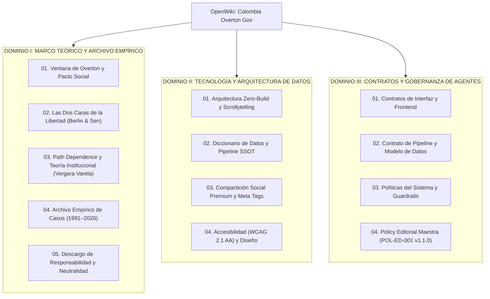

# OpenWiki — Colombia Overton Gov
## Centro de Conocimiento, Investigación y Fuente de Verdad Operativa
### Análisis del Impacto Institucional y la Tensión Democrática sobre la Constitución de 1991 (1991–2026)

Bienvenido al portal central de **OpenWiki** para el proyecto **Colombia Overton Gov**.

Este repositorio documental unificado constituye la **única fuente de verdad autorizada (SSOT)** para investigadores académicos, analistas políticos, periodistas de datos, desarrolladores web y agentes autónomos de IA.

---

## 1. Mapa de Navegación por Dominios de Conocimiento

La documentación del sistema está rigurosamente organizada en **tres dominios ortogonales** que desacoplan taxativamente los datos empíricos, la conceptualización teórica y los contratos normativos de gobierno:

---

## 2. Índice Detallado de Módulos

### 📚 Dominio I: Marco Teórico y Archivo Empírico
*Para investigadores en ciencias sociales, politólogos, juristas, periodistas y ciudadanía deliberante.*

| Documento | Alcance y Contenido Clave | Enlace Directo |
| :--- | :--- | :--- |
| **Ventana de Overton y Pacto Social** | Definición analítica de la Ventana de Overton aplicada a la degradación institucional. El pacto de la Constitución de 1991 como marco normativo, la esfera pública de Habermas y la normalización de lo intolerable. | [Ver Documento](./01-marco-teorico/01-ventana-overton-y-pacto-social.md) |
| **Las Dos Caras de la Libertad** | Tensión entre libertad frente al abuso (*libertad negativa*) y capacidad para decidir (*libertad positiva / sustantiva*). Diálogo conceptual con el ensayo de Isaiah Berlin. | [Ver Documento](./01-marco-teorico/02-dos-caras-de-la-libertad.md) |
| **Path Dependence y Teoría Institucional** | Modelo de dependencia de la trayectoria basado en Vergara Varela (2020). Los tres mecanismos de inercia y la evolución del Estado entre planificación (1960–1989) y apertura (1990–2020). | [Ver Documento](./01-marco-teorico/03-path-dependence-y-teoria-institucional.md) |
| **Archivo Empírico de Casos (1991–2026)** | Fichero documental completo de los 19 casos de estudio de producción, ordenados cronológicamente con sus 32 artículos constitucionales, montos, víctimas, sentencias y fuentes primarias. | [Ver Documento](./01-marco-teorico/04-archivo-empirico-de-casos.md) |
| **Descargo, Neutralidad y Límites** | Declaración de neutralidad política multipartidista, naturaleza no jurídica de las métricas interpretativas y delimitación epistemológica de responsabilidad. | [Ver Documento](./01-marco-teorico/05-descargo-neutralidad-y-limites.md) |

---

### 💻 Dominio II: Tecnología y Arquitectura de Datos
*Para ingenieros de datos, desarrolladores frontend y diseñadores web accesibles.*

| Documento | Alcance y Contenido Clave | Enlace Directo |
| :--- | :--- | :--- |
| **Arquitectura Zero-Build y Scrollytelling** | Estándares web puros (HTML5, CSS3, ES6+ vanilla), panel sticky con termómetro de inercia acumulada, desbloqueo secuencial de tarjetas con IntersectionObserver. | [Ver Documento](./02-tecnologia-y-arquitectura/01-arquitectura-zero-build-y-scrollytelling.md) |
| **Diccionario de Datos y Pipeline SSOT** | Arquitectura SSOT (`data/casos_fuente.csv` $\rightarrow$ `build_database.py` $\rightarrow$ SQLite `dist/data.db`, JSON y CSV limpios). Esquema de 19 campos y vocabularios controlados. | [Ver Documento](./02-tecnologia-y-arquitectura/02-diccionario-de-datos-y-pipeline-ssot.md) |
| **Compartición Social y Meta Tags** | Botoneras monocromáticas premium sin rastreadores externos (Web Intents) y configuración de previsualizaciones Open Graph para redes sociales. | [Ver Documento](./02-tecnologia-y-arquitectura/03-guia-comparticion-social-y-meta-tags.md) |
| **Accesibilidad y Diseño Responsivo** | Tipografía editorial, variables de tema, contraste WCAG 2.1 AA ($> 4.5:1$), áreas de pulsación $\ge 44 \times 44\text{ px}$ y adaptabilidad móvil sin overflow horizontal. | [Ver Documento](./02-tecnologia-y-arquitectura/04-accesibilidad-y-diseno-responsivo.md) |

---

### 🛡️ Dominio III: Contratos de Gobierno y Supervisión de Agentes
*Para agentes autónomos de IA, revisores de PRs y pipelines de integración continua.*

| Documento | Alcance y Contenido Clave | Enlace Directo |
| :--- | :--- | :--- |
| **Contratos de Interfaz y Frontend** | Invariantes del DOM, actualización sincronizada del panel sticky, preservación de estado y aislamiento de estilos. | [Ver Documento](./03-contratos-y-tests/01-contratos-de-interfaz-y-frontend.md) |
| **Contrato de Pipeline y Modelo de Datos** | Invariantes de datos: unicidad de `caso_id`, inmutabilidad histórica, prohibición de edición manual sobre `/dist` y validación de tipos atómicos. | [Ver Documento](./03-contratos-y-tests/02-contrato-de-pipeline-y-modelo-de-datos.md) |
| **Políticas del Sistema y Guardrails** | Desacoplamiento estricto fáctico-interpretativo, prohibición de sesgos partidistas, preservación de citas primarias y reglas de contribución. | [Ver Documento](./03-contratos-y-tests/03-politicas-y-guardrails.md) |
| **Policy Editorial Maestra (POL-ED-001)** | Contrato canónico de gobernanza epistemológica: 8 vectores normativos, matriz de autonomía para agentes (Nivel 1 vs. Nivel 2), blindaje anti-drift conceptual, plantilla de auditoría y checklist de 20 puntos. | [Ver Documento](./03-contratos-y-tests/04-policy-editorial-maestra.md) |

---

## 3. Principio Rector: Desacople Fáctico-Interpretativo

En estricta concordancia con la **Policy Editorial Maestra POL-ED-001 (Vector 2)**, este repositorio mantiene una separación taxativa e infranqueable entre dos capas:

1. **La Capa Fáctica («Hechos Duros»):**
   - Fechas, sentencias judiciales ejecutoriadas, informes oficiales (ONU, CIDH, Cortes, Defensoría) y montos certificados.
   - Reside exclusivamente en las columnas tipadas de `data/casos_fuente.csv` y se compila sin distorsiones en `dist/data_clean.json`.
2. **La Capa Conceptual («Lente Analítico»):**
   - El modelo de la Ventana de Overton, las dimensiones de libertad negativa/positiva, la teoría de *path dependence* y las métricas cualitativas (`overton_gravedad`, `overton_novedad`, `nivel_responsabilidad`).
   - Se explicitan con rigor como hipótesis y herramientas hermenéuticas para la deliberación ciudadana, sin presentarse jamás como fallos jurídicos ni dogmas indiscutibles.
